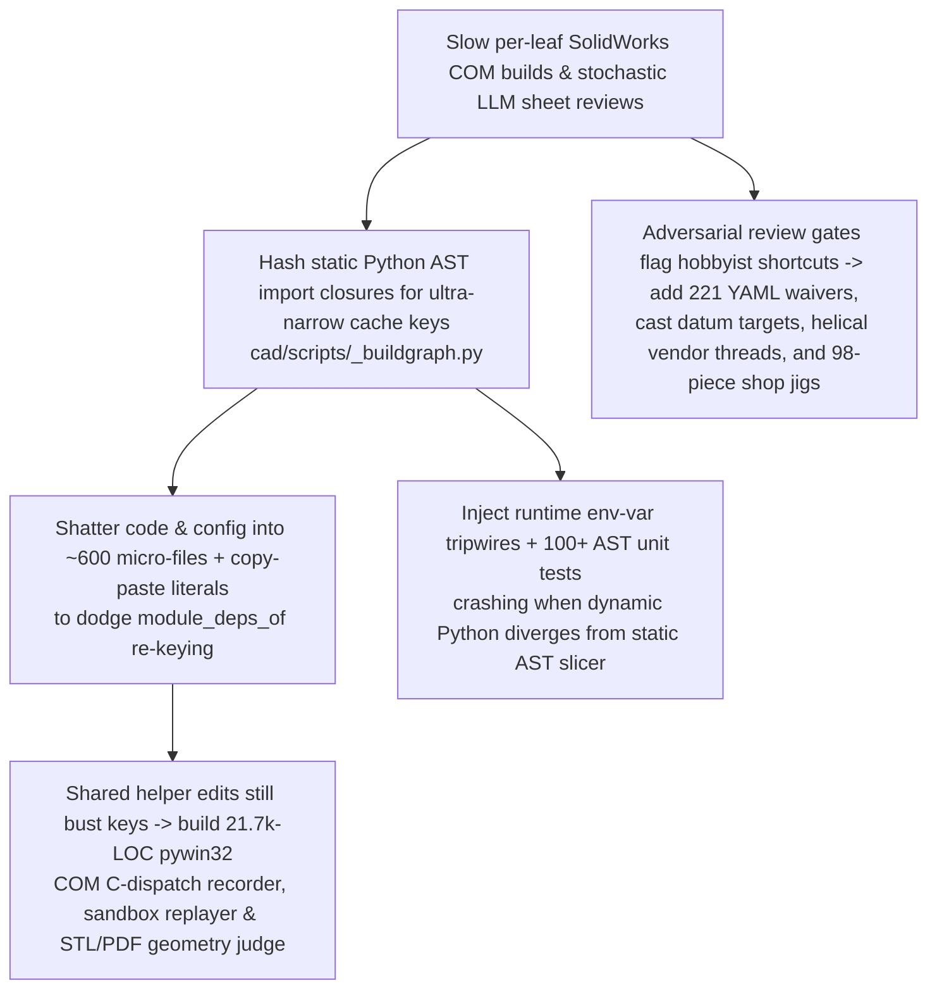

# Codebase & CAD Overengineering Audit (2026-11-16)

- **Audited baseline:** `origin/main` @ `b92c2e9a2f` (`SolidworksMCP-python` @ `09dd4660d7`)
- **Worktree:** `C:/src/ha-overeng-audit-20261116`
- **Status:** Draft audit & simplification roadmap for owner review / inline comments

---

## 0. Macro Scale Snapshot

The core physical deliverable is a quantity-one, hand-cranked (~1 rpm, zero-power) hobby-shop reconstruction of Albert Michelson’s 1898 20-element Fourier harmonic analyzer (**100 fabricated machine parts** and **9 machine assemblies**, built on a manual mill and lathe with DROs).

Around those ~109 core CAD models, the repository currently carries **~1.12M lines of code and structured configuration** (excluding `cad/docs/`’s 332k lines of Markdown and `web/content/`’s ~450 MB of tracking JSON):

| Layer | Files | Lines (LOC) | Share | Primary Driver |
|---|---:|---:|---:|---|
| `cad/scripts/test_*.py` + `tests/*.py` | 426 | 326,586 | 29.2% | 206 drawing tests (175.2k LOC), AST/source cops, cache/replay/farm mocks |
| `SolidworksMCP-python/` (`src` + `tests`) | 267 | 227,219 | 20.3% | 102.4k makepy + 23.0k active adapter + **94.9k unused MCP/UI/agent/test weight** |
| `cad/scripts/draw_*.py` + drawing/layout helpers | 352 | 190,043 | 17.0% | Hand-coded sheet coordinates, cold-reopen COM readbacks, 84 COTS vendor sheets |
| `cad/scripts/build_*.py` + `*_spec.py` + `*geom*.py` | 504 | 170,003 | 15.2% | 196 part builders, 13 assembly monoliths, 244 spec modules |
| `cad/scripts/_*.py` + pipeline/review/gate infra | 246 | 124,780 | 11.2% | AST buildgraph, blob cache, COM shadow replay, LLM review, verify/forensics |
| `cad/scripts/diagnostics/*.py` | 254 | 48,568 | 4.3% | 82 McMaster SKU B-rep reverse-engineering scripts + COM diagnostic probes |
| `cad/config/**` + `cad/process/**` + `dodo.py` + `build.py` + `scripts/` | 306 | 36,158 | 3.2% | 239 micro-YAMLs, 8 jig `plan.toml`s, 6.5k `dodo.py`, 2.3k `farm-run.ps1` |

A single self-reinforcing feedback loop accounts for most of the accidental complexity across both software and CAD:

---

## 1. Earned Complexity (Keep — Do Not Cut)

Roughly 10–15% of the codebase solves hard Windows, SolidWorks COM, or historical-physics constraints and should be preserved:

1. **Single-STA COM seat serialization & out-of-band crash/modal watchdog** (`dodo.py:204-355`, `cad/scripts/_watchdog.py`, `cad/scripts/_sw_lifecycle.py`, `cad/scripts/_session.py:101-129`):
   - SolidWorks runs in a Single-Threaded Apartment, leaks commit charge across long runs, blocks the calling thread indefinitely on Win32 `#32770` modals, spawns `sldexitapp.exe` hours before WER logs land, and share-locks open files/directories (`WinError 32`).
   - Machine-global `filelock`, the daemon watchdog (`os._exit(86..89)`), `ISldWorks.StartupProcessCompleted` gating, title-ordered dirty-document closing, and parking SolidWorks’ `cwd` in `%TEMP%` are genuinely earned.
2. **Checked-in early-bound `makepy` bindings & strict `[out]` parameter checks** (`SolidworksMCP-python/.../_generated/sldworks_2026.py`, `cad/scripts/_com.py:48-98`):
   - Prevents concurrent `gen_py` cache corruption and blocks silent fallback to late-bound `CDispatch`, where 542 `[out]` methods (such as `GetWhatsWrong`) otherwise leave `VT_BYREF` outputs empty ("no errors").
3. **Recipe staleness vs. `.execution` binary identity + create-only `If-None-Match` blob publication** (`dodo.py:567-629, 3216-3291`, `cad/scripts/_artifact_cache.py:1020-1045`):
   - Saving a parent `.SLDASM` rewrites metadata bytes in child `.SLDPRT`s (breaking naive byte-hash staleness), while rebuilding a `.SLDPRT` from identical Python source mints new internal CAD face/edge PIDs that break parent mates. Separating recipe digests from `.execution` SHA-256 tokens + first-writer canonical archives solves a real binary-CAD cache hazard.
4. **Seat-free release packaging & PDF ink hashing** (`cad/scripts/package_native.py`, `cad/scripts/_pdf_ink_digest.py`):
   - Isolating SolidWorks `IPackAndGo` into `package_native.py` (643 LOC) keeps `cut_release.py` seatless; hashing 144 DPI raster ink + sorted text in `_pdf_ink_digest.py` (71 LOC) defeats SolidWorks’ per-export PDF `/ID` and timestamp churn.
5. **Michelson mechanism geometry & sensitivity math** (`cone_line.py`, `channel_kinematics.py`, `paper_drive_geom.py`, Layer 1 of `error_budget.py`):
   - Exact inclined cone-shaft geometry ($\sin(i) = \Delta r / \Delta z$), deterministic machine-frame subassembly placement (`IDENTITY` in `ha-harmonic-analyzer.SLDASM`), and uncovering the null-station offset and $1.5^\circ$ cam-home phase error (`#749`).
6. **Inscribed-angle virtual-center trammel principle & frozen visible COTS 3D geometry**:
   - Under the book’s manual-mill constraint, cutting $R800/R816\text{ mm}$ ($31.5\text{ in}$) arcs whose center lies $\sim 24\text{ in}$ off an $8.25\text{ in}$ bench-mill table genuinely motivates a virtual-center inscribed-angle guide.
   - Freezing each purchased SKU’s visible 3D silhouette (heads, slots, hex sockets, eye loops, chain links, spring coils) in code keeps renders, `web/` landmarks, and assembly mates deterministic over time.

---

## 2. Track A — Software Architecture Overengineering

### A1. `SolidworksMCP-python` Submodule Baggage & Fake-Async Ceremony

| Submodule Slice (`SolidworksMCP-python/`) | Files | LOC | Imported by `cad/scripts/`? | Folded into `dodo.py` COM Cache Keys? |
|---|---:|---:|---|---|
| `adapters/_generated/sldworks_2026.py` | 2 | 102,450 | Yes (early binding) | Yes (all tiers) |
| Active COM adapter core (`pywin32_adapter`, `solidworks/*.py`, `base`, `sw_type_info`, `sw_recovery`, `com_variant`, `raw_dispatch`) | 25 | 22,954 | Yes (`72/98` methods; `41/53` models) | Yes (part tier drops `assembly`, `motion`, `drawing`) |
| Unused adapter wrappers (`mock_adapter` `3,636`, `circuit_breaker` `1,228`, `connection_pool` `1,153`, `factory`, `vba_adapter`, `intelligent_router`, `response_cache`) | 10 | 7,555 | **0 calls**, yet **eagerly imported on every COM boot** via `adapters/__init__.py:7-20` | **Yes — all tiers** |
| Unimported server/UI/agent code (`tools/` `17,211`, `ui/` `10,848`, `agents/` `4,194`, `server*.py`/`security/` `2,088`) | 69 | 34,341 | **0 imports** | **Yes — all tiers** |
| Submodule `tests/` | 149 | 53,714 | Never | Excluded |

- **Cache-key & `.venv` contamination (`dodo.py:1626-1655, 1707-1740`)**: Because `dodo.py` hashes `tools/`, `ui/`, `agents/`, `server*.py`, `mock_adapter.py`, `circuit_breaker.py`, and `connection_pool.py` into all three submodule digest tiers, a typo fix in an unused Prefab UI widget invalidates **all 417 COM cache keys**. Meanwhile `SolidworksMCP-python/pyproject.toml:31-51` pulls `fastmcp`, `pydantic-ai`, `sqlmodel`, `sqlalchemy`, `aiosqlite`, and `uvicorn` into every worker environment, and `adapters/__init__.py:7-20` imports `ConnectionPoolAdapter` (impossible on a single-STA `GetActiveObject("SldWorks.Application")` server!) on every subprocess launch.
- **Fake `async def` + `AdapterResult` + 53 Pydantic bags around synchronous STA calls**:
  - **189 of 201 `async def` methods** in `adapters/` contain **zero `await` expressions** (`adapters/solidworks/features.py:35-99` is 12 `async def` one-liners calling synchronous functions). That forces **1,406 `async def` functions** and **10,933 `await`s** across non-test `cad/scripts/*.py` for zero concurrency.
  - `_handle_com_operation` (`pywin32_adapter.py:1831-1887`) catches `Exception` (discarding tracebacks), formats strings into `AdapterResult`, and is immediately unboxed back into `RuntimeError` via `check(label, await adapter.foo(...))` **3,937 times** across `cad/scripts/`. Validated Pydantic `BaseModel` inputs (`adapters/base.py`, `3,088` LOC) are even copied *again* into `SimpleNamespace` inside `_create_extrusion_impl` (`features.py:166-176`).
- **Bypassing, duplicating & AST-policing the adapter**:
  - `cad/scripts/` bypasses the adapter constantly (`adapter.currentModel` 1,503× across 476 files; `_early_bound` 5,892×; `adapter._attempt` 877×).
  - `adapters/raw_dispatch.py` (`84` LOC) and `cad/scripts/_com.py:101-190` (`90` LOC) are copy-pasted clones of `_RecordedInvoke`; `_read_member` is duplicated 4 times across both repos.
  - Instead of running `pyright` on synchronous typed functions, `test_pd_transgear_adapter_contract.py:74-96` and `test_sm_summing_lever_adapter_contract.py` (`1,943` LOC combined) **re-implement Python’s C3 MRO linearization algorithm over raw ASTs** to catch method-name typos in **3 out of 417** scripts.
- **Boring replacement**: Extract a synchronous, typed `pywin32` SolidWorks helper package (~8k LOC + `sldworks_2026.py`) that raises directly on COM errors; drop MCP/UI/agents/pool, Pydantic input bags, `AdapterResult`, fake `async`, and custom C3-MRO AST tests.

---

### A2. Custom Python AST Compiler (`_buildgraph.py`), Runtime Env-Var Tripwires & 500-File Fission

- **Static Python subset compiler (`cad/scripts/_buildgraph.py`, `2,683` LOC)**:
  - `_AssemblySources` (`lines 170-844`, `675` LOC) statically interprets lexical scopes, loop-carried dict mutations, tuple unpacking, `_module_call_graph` (`lines 2478-2629`), and AST sub-file slicers for `_drawing_registry.py`, `_assembly_contract.py`, `_fastener_catalog.py`, and `_shop_records.py` (`lines 1437-2080`), cached in a custom SHA-256 pickle store (`_FactStore` with `_BuiltinsOnly` unpickler and NTFS `_RACY_NS` guard, `lines 988-1150`).
  - Because static AST analysis over Python is unsound whenever code uses helper indirection, `dodo.py:724-734, 1936-2145` injects serialized allowlists (`HARMONIC_FIT_GROUPS`, `HARMONIC_FASTENER_ROWS`, `HARMONIC_SHOP_RECORDS`) into subprocess environments so `_config.py:149-155`, `_fastener_catalog.py:529-535`, and `_shop_records.py:67-85` crash at runtime if dynamic execution reads an entry the AST analyzer did not predict.
- **Extreme module & YAML micro-fragmentation**:
  - Because `module_deps_of()` hashes entire imported `.py` files, **223 of 1,189 non-test Python files (18.8%)** explicitly state in comments/docstrings that they were split to avoid re-keying caches:
    - **328 `cad/scripts/_*.py` helpers** (`96,449` LOC), of which **119 are $\le 60$ LOC**—including **62 `_mcmaster_*.py` files** averaging 33 LOC down to **3 LOC** (`_mcmaster_90280a194.py`), **6-LOC** fit modules (`_fit_ream_h7.py`, `_fit_ream_slide.py`, `_fit_shaft_h.py`), and split `_simplified_{identity,names,bom,part}.py`.
    - **6–8 satellite Python files per assembly** (`build_*`, `*_spec`, `*_explode_spec`, `_*_explode`, `_*_interference`, `*_sheet`, `*_steps`, `draw_*`), down to 7–9 LOC files (`dt_cone_pivot_post_installation.py`, `ch_rocker_arm_tl_oblique_feed_block_notes.py`).
    - **239 YAML files** (`19,720` LOC), including **197 per-part YAMLs** averaging **19.9 LOC**, re-aggregated at runtime by `_config.py:36-85`.
  - Authors even **copy-paste numeric literals across files** to dodge import edges (`dt_cone_tip_block_spec.py:576`: `# a copy so this part does not re-key...`; `_ha_harmonic_analyzer_interference.py:181-183`; `test_buildgraph.py:3141`), then maintain *lockstep unit tests* (`test_station_pitch_lockstep.py`) to check that the copy-pasted numbers still match.
- **Boring replacement**: Consolidate `parts.yaml`, `tolerances.yaml`, and `fasteners.yaml`; normalize ASTs (stripping comments/docstrings) and compute cache keys by hashing each target’s **evaluated pure-Python input dictionary** + builder AST + child `.execution` tokens before launching SolidWorks. Value-hashing resolved inputs ignores unrelated SKUs/rows automatically without AST dataflow compilers, env-var traps, or 3-line files.

---

### A3. 21,695-LOC `pywin32` Shadow COM Conversation Recorder, Replayer & Geometry Prover

Built in 8 days (61 commits starting `2026-11-09`), `cad/scripts/_com_conversation.py` (`3,734` LOC), `_replay_shadow.py` (`4,116` LOC), `_com_outcome.py` (`2,852` LOC), `com_replay.py` (`966` LOC), `_component_order.py` (`87` LOC), and tests (`9,940` LOC) build a speculative COM call-stream cache on top of the Azure Blob cache:

- **Fragile C-dispatch & import-hook monkeypatching**: Monkeypatches `win32com.client.DispatchBaseClass.__init__` and `_get_good_single_object_`, swaps the `VARIANT.value` property descriptor **during every COM call** (`_com_conversation.py:1919-2035`), runs Python under `sys.addaudithook` (`Sandbox`), and installs a `sys.meta_path` loader (`com_replay.py:637-731`) to mutate `_drawing_types.DrawingSpec` properties at import time without changing `_drawing_types.py`’s hash.
- **Perturbs live SolidWorks builds (`#2824`)**: Recording `drawing:pd_paper_drive_assembly` corrupted SolidWorks 34.4.0’s `SectionAssembly` into a self-referential component loop (6/6 recorded runs hung to 900s watchdog kills vs. 4/4 unrecorded passes), requiring `UNRECORDED_LABELS` (`_replay_shadow.py:295-303`).
- **2,852-LOC nondeterminism whack-a-mole (`_com_outcome.py`)**: Zeroes subnormal floats leaking x64 DLL base addresses from `ISurface.CylinderParams` (`lines 2043-2051`), runs $2^{25}$-ULP bipartite matching on leftover answers, union-finds 4-ULP STL coplanar boundary polygons (`lines 2521-2738`), and runs graph-degree topology checks to forgive random SolidWorks jagged crop-view wiggles (`lines 2270-2488`).
- **Disproportionate payoff vs. universal overhead**:
  - Reuse only triggers when a recipe’s cache key misses yet Python emits the **exact same COM call sequence** (comment/docstring edits or untouched helpers in shared files).
  - Today **0 of 208 drawings** and **only 4 of 13 assemblies** (`DEPENDENT_SERVE_LABELS` — explicitly the 4 smallest/fixture assemblies, `_replay_shadow.py:171-188`) can ever be served. Yet all 195 part drawings (`DRAWING_AUDIT_ONE_IN = 1`) and the 9 largest assemblies still run pre-build offline replays, execute SolidWorks under `RecordingProxy`, gzip every output file a second time, and upload up to 512 MiB `com-replay/` sidecar tars to Azure on every `rw` miss.
- **Boring replacement**: Delete the entire 21.7k-LOC replay subsystem; strip comments/docstrings in Python AST hashing and narrow spec inputs by value (A2) to get deterministic no-op cache hits in ~150 LOC.

---

### A4. 7-Layer Multi-Language Farm Launch & Re-Verification Stack (`14,396` LOC w/ Tests)

1. **Seven stacked orchestration layers**:
   - `scripts/farm-run.ps1` (`2,314` LOC PowerShell 7.3 + 84 LOC embedded C# `CreateJobObjectW` P/Invoke + WMI `Win32_Process` polling + physical symlink chain resolver)
   - $\to$ `build.py` (`962` LOC manual `getopt` re-parser `_loader_parse`, `TaskControl` shallow-copy cloner, `_FarmDoitMain` monkeypatch, nested `uv run` subprocesses into `solidworks-pool`)
   - $\to$ `dodo.py` (`6,505` LOC, including duplicate `canonical_tasks` / `canonical_target_owners` selective loaders at `lines 6057-6398` + 4 freshness ledgers in `export_models.py`)
   - $\to$ `cad/scripts/_farm.py` (`972` LOC Temporal `BuildFifo7` client + `.requests/*.json` breadcrumbs)
   - $\to$ external `solidworks-pool` worker
   - $\to$ `cad/scripts/_selected_execution.py` (`425` LOC canonical JSON schema-3 / protocol-7 / symlink-junction alias re-verifier)
   - $\to$ `farm-run.ps1 -Watch/-Status` regex-scraping human console stdout (`Read-RunLog`, `lines 846-936`: `[cache] HIT`, `TaskError - taskid:`).
2. **Triple-duplicated preflights**: `.farm-sources.json` normalization, Unicode BiDi control-character checks (`\u061C`, `\u200E..\u2069`, $\le 160$ runes), and git cleanliness (`checkout_drift`) are re-implemented in PowerShell, `build.py`, and `_farm.py` (before *every* leaf dispatch, even inside `farm-run.ps1`’s immutable detached snapshot).
3. **Boring replacement**: Replace `farm-run.ps1` + `build.py` `DoitMain` wrappers + `_selected_execution.py` with a single ~700-LOC Python CLI (`farm_build.py`) that snapshots `HEAD`, computes cache misses in Python, drives Temporal `BuildFifo7` in one `asyncio` loop, and writes a structured `.status.json` directly (zero PowerShell/C#/WMI/stdout-regex scraping).

---

### A5. In-Repo Multi-Agent LLM Tribunal, Auth Broker, MCP Server & Dual Eval Suites (`22,696` Python LOC + `6,550` Data/Doc LOC)

While a shared hobbyist anti-overspecification rubric (`drawing-guidelines.md`) and `_pdf_ink_digest.py` (`71` LOC) are earned, `cad/scripts/machinist_review*.py` builds an entire multi-provider agent platform inside the CAD repo:

- **Win32 DACL + OMP system-prompt regex lock**: `machinist_review_credentials.py` (`302` LOC) enforces Win32 SID/DACLs on a hard-coded 3-key file (`len(keys) != 3` fails, `L105`) under dual `FileLock` + `O_EXCL` locks. `machinist_review_transport.py` (`1,113` LOC) scrapes billing reset timestamps from prose, spawns `omp auth-broker` + `omp --mode rpc`, and regex-validates OMP v18.7.0’s internal `<critical>` system prompt verbatim (`L52-82` — so an upstream OMP wording tweak breaks CAD drawing gates), while `machinist_review.py:625-713` hardlinks and repairs `~/.codex/auth.json`.
- **865 LOC of zero-trust rollout forensics against its own child processes**: `machinist_review.py:715-1204` and `machinist_review_eval.py:544-918` parse `~/.codex/sessions/**/rollout-*.jsonl` and SHA-256 route-offset manifests to prove its own subprocess actually viewed the sheet, after spinning up `asyncio.run` (`_sheet_resource_manifest`, `L317-351`) to inspect its own `FastMCP` server (`machinist_review_sheets_mcp.py`, `909` LOC including `355` LOC of raw PDFium C-API tolerance-stack OCR clustering).
- **Dead diff-precheck path + `uv.lock` cache-key coupling**:
  - `machinist_review.py` implements red/blue PDF diff overlays, `--preserve-color` MCP serving, and stateful judge session `--resume`, **none of which ever execute in `build`/`release`** because `dodo.py:4154` hardcodes `--force` (`dodo.py:3886-3887`).
  - Instead, `dodo.py:3990-4145` + `_review_carry.py` download up to 8 historical PDFs from Azure sidecars to carry verdicts across 1-px/68-grey antialiasing diffs—needed because even a 4-session Opus ensemble has a **~7% false-positive `FIX` rate per roll on unchanged ink** (`dodo.py:4005`).
  - `dodo.py:3929-3930` hashes `pyproject.toml` and `uv.lock` *whole* into every review key, so bumping `pytest` invalidates all 207 drawing verdicts (forcing `prechips` out of `uv.lock` in `#2502`).
- **Two separate benchmark harnesses + custom web viewer in `cad/scripts/`**: `machinist_review_eval.py` (`1,080` LOC; its `2,815`-LOC test sits unenrolled in `PENDING_TRIAGE`) and `machinist_review_bench.py` (`1,573` LOC + `5,100`-LOC `evals.json` + 290 LOC of inline OKLCH CSS and `MutationObserver` iframe DOM-patching).
- **Boring replacement**: Render full-sheet + static view-bbox PNG crops via `pypdfium2` in ~80 LOC and call the official Python SDKs directly (~500 LOC total in-repo); decouple `uv.lock` from review keys; move benchmark datasets and HTML viewers out of `cad/scripts/`.

---

### A6. Success-Path Seat Forensics, Multi-Provider OTel Hacks & Redundant Verification Gates

- **Success-path COM/Win32 polling in `_seat_forensics.py` (`2,047` LOC + `4,429` test LOC)**:
  - Runs on the **success path of every part and drawing build** (`record_authoring_context`, `record_drawing_display`), executing **~45 COM and Win32 `ctypes` calls** per build (30 individual `GetUserPreference*` round-trips, `WTSQuerySessionInformationW`, 4 projected 3D points for `px_per_mm`) because of one 2026-09-17 screen-space sketch-snap bug whose real fix is `AddToDB = True`.
  - Guarded by `test_recipe_inert.py` (`418` LOC AST mutator/reachability prover) for a 1-element set `{"_seat_forensics.py"}`; companion `_sketch_closure.py` (`283` LOC) has **zero** production callers.
- **`_telemetry.py` (`1,955` LOC + `1,669` test LOC)**: Probes loopback sockets at `import` time (`L1955`), mutates private OTel `_TRACER_PROVIDER_SET_ONCE._done = False` internals (`L950-954`), maintains multiple `TracerProvider`s per process for Aspire resource-column routing, monkeypatches 37 adapter methods via `sys.modules`, and walks `sys._getframe` on every log call.
- **3×–4× redundant COM verification & non-blocking `joint_retention.py`**:
  - `save_assembly_and_images` already proves `ForceRebuild3`, DOF necessity/exact-set, deep `whats_wrong`, `check_no_interference`, close+reopen `NeedsRebuild2 == 0`, and 40× boolean `assert_assembly_spring_contacts`; `verify_soundness:<stem>` (`verify.py`) acquires the COM seat again to reopen the exact same `.SLDASM` and re-run them (`_run_soundness_battery` and `_verify_static_one` even copy-paste the same 8 gates inside `verify.py:951-1185`).
  - `preflight_release.py` (`uptodate: [False]`) opens 177-component `ch-channel.SLDASM` to check gear ratios (`ch-channel` has **0** gear mates!) while omitting `pd-paper-drive` (leaving `verify.py:447-452, 478-489` dead in preflight).
  - `joint_retention.py` (`2,577` LOC + `768` test LOC) triple-registers 180 parts and 52 joint prose essays with source-substring anchors, runs on every `doit build`, and **cannot fail** (`ENFORCEMENT = Enforcement.AUDIT`, `L58`, currently logging 4 ignored findings).

---

### A7. 326.6k-LOC Test Suite Dominated by AST Statement Locks & Bespoke Mock-COM Emulators

| Test Category (`cad/scripts/test_*.py` + `tests/*.py`) | Files | LOC | Share | What It Actually Tests |
|---|---:|---:|---:|---|
| Per-sheet & batch drawing tests (`test_*_drawing*.py`) | 206 | 175,226 | 53.7% | Fake COM emulators, exact `(X, Y)` sheet coordinates, `draw_*.py` AST/source locks |
| Buildgraph, cache, COM replay, farm & AST cops | 54 | 58,195 | 17.8% | `_buildgraph`, `dodo`, `_artifact_cache`, `_replay_shadow`, `farm-run.ps1`, import/symbol policing |
| Layout-audit, PMI/GD&T & sheet-purity tests | 31 | 21,946 | 6.7% | `_layout_audit`, legacy `_drawing_layout_check`, `_drawing_contract` AST bans |
| Automated LLM `machinist_review` tests | 6 | 13,572 | 4.2% | Mock SDK/OMP/Codex transcripts, raw PDF/PNG byte fixtures, HTML viewer escaping |
| Adapter, mock-save & supplier-driver tests | 31 | 13,380 | 4.1% | C3-MRO AST censuses, fake dispatch harnesses, `DisplayLists` zlib parsers |
| **Actual CAD geometry, kinematics, stacks & CAM math** | **98** | **44,267** | **13.6%** | **Earned core**: Fourier truth model, gear/mesh math, error budget, clearances, G-code checks |

- **213 test files (`242,082` LOC)** call `ast.parse` or `.read_text()` on repo Python source.
- Tests lock exact AST statement indices (`statements[profiles + 1] == "_add_view_arrow(adapter, front)"` in `test_ch_rocker_arm_drawing.py:165`; `build.body[setup_index + 1].value is quality` in `test_fr_top_frame_drawing.py:8082`), internal helper parameter names (`test_buildgraph.py:1545`), and verbatim multi-line source formatting (`test_ch_rocker_arm_drawing.py:128-131`).
- Individual offline drawing tests maintain **48 to 68 custom fake COM classes per file** (`test_ch_rocker_arm_drawing.py` = **9,849 LOC**; `test_purchased_fastener_drawing.py` = **9,289 LOC**; `test_fr_top_frame_drawing.py` = **8,189 LOC**) parametrizing 27 synthetic NaN/boolean COM corruption strings against the script’s own private `if/raise` branches—directly violating `drawing-simplicity-policy.md:751-752`.

---

## 3. Track B — CAD Models, Assemblies, Drawings, Tooling & Travelers Overengineering

### B1. Shop Tooling (`*_tl_*`) & the Manual-Mill / CNCjs-EL400 Boundary (`76,546` Lines Across `245` Files)

#### 1. Policy Boundary vs. Current `cad/` Drift
- **Intended project rule** (`book/README.md:4-5`, `kickstarter/campaign/faq.md:25-28`, `logbook/entries/2026-10-29-vise-install-and-first-cuts.md:26-28`): The book targets a reader with a **manual mill and lathe with DROs**. Although the owner’s PM-30MV happens to be CNC-converted, that conversion is incidental—it is meant to be operated as a manual mill through **CNCjs** using a pendant handwheel and CNCjs’s **simulated EL400 DRO**.
- **Two documentation & engineering contradictions in `origin/main` today**:
  1. `EL400` and `CNCjs` appear **zero times** across `AGENTS.md`, `cad/docs/*`, `cad/process/README.md`, `cad/process/shop.toml`, and `cad/config/shop-equipment.toml` (living only in `logbook/entries/` and one superseded `hand-travelers/*.html`). Contributors reading `cad/` see `[cnc.pm-30mv] control = "GRBL", drive = "ballscrews on X and Y"` (`shop-equipment.toml:372-378`) and `tolerance-gdt-assessment.md:563-567`.
  2. `cad/` actively leaked CNC dependencies into the oblique jig’s own base bar (`TL-20`): `cad/process/ch_rocker_arm_tl_oblique_base_bar/cam.py` (`434` LOC, `cam_nc.py` stack = `2,129` LOC) generates **9 FreeCAD CNC G-code programs (`BB01`–`BB09`)** exploiting ballscrew climb-zigzag facing (`L32`), and `ch-rocker-arm-tl-oblique-base-bar.yaml:46-47` (`RV-04`) **justifies `TL-20`’s tight `±0.05 mm` rail-hole tolerance by charging `±0.02 mm` CNC ballscrew repeatability**—a stack a manual-mill + EL400 reader cannot reproduce.

#### 2. What Remains Overengineered Strictly Under "Manual Mill + EL400 DRO"
Even holding the manual-mill + EL400 rule fixed (making the inscribed-angle virtual-center guide earned for $R800/R816\text{ mm}$ arcs):
- **Mechanical overkill (`22` part numbers, `98` physical pieces)**: To finish-mill two concentric arcs (`.020 in` / `0.51 mm` profile zone) on a `.098 in` mild-steel strap, `MHA-CH-06-TL-00` designs a miniature machine tool with 4× HGR15 linear rails & HGH15CA ball carriages, a lathe/mill-reworked Tr8×2 leadscrew + brass nut, 2× KP08 pillow blocks, crank handwheel, feed block, feed lever, precision shim packs, 52-pc clamping kit, and a `20.5 × 5.1 in` carrier too wide for the 6" vise—plus tools the shop does not own (`shop-equipment.toml:998-1026`). On a manual mill after rough bandsawing near the scribe line, two straight guide bars/slots + two shoulder/cam-follower pins (or chordal step-milling on the EL400 + filing to `arm-outline-template`, `shop-equipment.toml:54-70`) achieve `.020 in` profile accuracy with a fraction of the hardware.
- **Software, drawing & traveler overkill (`64,851` lines across `193` files for one jig)**:
  - `ch_rocker_arm_tl_oblique_jig_assembly_spec.py` (`3,435` LOC): Models Kienzle specific cutting force ($k_{c1}=1500\text{ MPa}$), 1,361 N one-hand abuse thrust, ISO 2903 screw efficiency, circle-circle lens bearing pressure on uxcell Zamak-3 feet, Mitutoyo 81-block wringing stacks, and `0.02 mm` TIR qualification on cheap Amazon rail carriages.
  - `draw_ch_rocker_arm_tl_oblique_jig_assembly.py` (`3,557` LOC, 12 sheets) + `6,350` test LOC; `5,887` LOC (`draw` + `test`) for reworking a $15 Amazon leadscrew; **14 unmodified COTS `.SLDDRW` drawings** for jig screws/washers/blocks/handwheel.
  - **All 8 `prechips` travelers in the repo (`cad/process/*/plan.toml`, `2,984` LOC)** are written for this jig’s parts (**0** for the 100 fabricated analyzer parts), spending 337–500 lines of Euler-Bernoulli beam-support coordinates on 22-LOC rectangular blocks (`TL-22`, `TL-32`).
- **Other `*_tl_*` items (`dt_cone_*_tl_*`, `14,189` LOC)**: `dt-cone-gear-tl-index-plate.yaml:5` models and tolerances (`⌖ Ø.004 | A`) **132 reamed holes** with `.02–.03"` webs while noting *"Every size is a best guess pending the owner's measurement of his BS-0 plate (#2157)"*; `build_dt_cone_gear_tl_indexing_assembly.py:11-12` places two unconnected tools in empty space solely to satisfy `test_part_coverage.py`.

---

### B2. Procedural COTS Hardware: Freezing SKUs & `web/` Renders vs. Ongoing Tax (`~141.8k` LOC)

#### 1. Goal & Earned Core vs. Measured Repo Tax
- **Valid goal (preserve):** Freeze each purchased SKU’s geometry in tracked code/data so silent vendor changes never shift CAD mates, renders, or `web/` video-sync landmarks (`web/content/*.observations.json`), and keep crisp visible 3D features (slotted/hex heads, sockets, eye loops, chain plates, spring coils).
- **Why the current pipeline is *not* a sunk 1-time cost (`origin/main` data)**:
  - **543 git commits** have touched `cad/scripts/diagnostics/`, `_stock_fastener.py`, `_simplified_part.py`, and `_supplier_*_model.py` (leaving `14` orphaned `diag_build_*.py` files = `2,311` LOC).
  - **Hurts `web/` size & drawings via swept 3D helical `ThreadGroove`s**: **79/82** `diag_build_<SKU>.py` recipes sweep real 3D helical threads—~90% buried invisible inside tapped bores, the rest sub-pixel aliasing on `#0-80` to `#4-40` shanks. Because `export_models.py` exports the threaded `Default` configuration into `ha-harmonic-analyzer.glb` and `web/DESIGN.md:151-153` forbids mesh simplification/quantization, **`models/ha-harmonic-analyzer.glb` is `41.1 MB`** (`41,072,516` bytes *after* exact dedup + `meshoptimizer@0.22.0`, `web/content/model-representation.json:17`), while 2D drawings needed the entire **`_simplified_part.py` (`617` LOC) save-close-reopen `<Config> Simplified` pipeline** across 90 builders to avoid black-ink thread blobs, plus **`252` manual mm³ `ALLOWED_PAIRS` entries**.
  - **Clones arbitrary CAD-artist details instead of functional specs**: `diag_mcmaster_lib.py:13-23` gates `0.02%` volume and sorted face-area multisets (up to 3,974 knurl faces; `1,097` LOC in `diag_build_1330K524.py` matching a 3° internal Bezier spring kink to `1.5e-7 mm`), which actually hampers sourcing a substitute if a vendor disappears.
  - **Bundles 3D model freezing with 74 unmodified 2D `.SLDDRW` sheets**: Every unmodified washer, screw, and Sharpie (`draw_pn_vn_pen_marker.py`, `391` LOC) injects hidden 3D witness sketches (`_supplier_washer_model.py`, `_supplier_spring_reference.py`), builds a 4-view `.SLDDRW` stating `"PURCHASED PART, USED AS SUPPLIED"`, runs `test_purchased_fastener_drawing.py` (`9,289` LOC), and triggers 4 Opus `machinist_review` sessions.

#### 2. Agreed Replacement Architecture (ASME Y14.24 Three-Tier COTS Strategy)

| COTS Tier | HA Count | 3D `.SLDPRT` Strategy (Frozen in Code) | 2D Drawing / Procurement Deliverable |
|---|---:|---|---|
| **1. Standard Normative Hardware** (`#4-40`/`#8-32` screws, nuts, washers, ASME dowels, `#25` chain, music wire) | **~58** | Keep existing visible heads/bodies; **drop/suppress helical `ThreadGroove`s** (export unthreaded shanks to GLB; build future SKUs from 10-line frozen catalog tables + ~40-LOC family primitives) | **Zero `.SLDDRW` sheets.** Emit one generated **Master Hardware Schedule** (`HARDWARE.md` / PDF) with generic ASME/ISO designation + max head/seat envelope + example SKU |
| **2. Non-Standard / Proprietary COTS** (springs, eye bolts, lock knob, `KP08` block, `HGR15` rail, marker `30051`) | **~16** | Keep clean visual/interface solids without reverse-engineering internal vendor kinks | **Specification Control Sheet / Table** (ASME Y14.24 §11): dimension **only functional interface & performance bounds** (`rate k`, `hook C-to-C`, `max OD`, `KP08` bore/bolt centers, pen barrel `Ø.41–.46"`) so any substitute or shop-wound replacement works |
| **3. Shop-Trimmed / Reworked COTS** (`pd-vn-transgear-pivot-screw`, `sm-vn-knife-hanger-stud`, `dt-cone-tip-end-screw`, cut dowels, `pd-feed-rack`, `leadscrew-kit`) | **~10** | Frozen blank + explicit cut/chamfer/hole feature (unthreaded shank) | **1-Sheet Altered-Item `.SLDDRW`** (ASME Y14.24 §10) via one ~120-LOC shared helper: `MAKE FROM: <generic ASME/blank spec; e.g. SKU>`, `(REF)` on 1–2 collet/datum features, and tolerances **only on shop cuts** |

---

### B3. Triple-Redundant CAD Assemblies, `flip_invert` Seeds & `CopyWithMates2` Gymnastics (`107.6k` LOC)

- **Exact Python 6-DOF transforms + full SolidWorks re-mating**:
  - Every component is inserted via `place_component` at its exact Python-solved 3D transform and checked at save not to move by `>0.5 mm` / `1e-3 rad` (`assert_pose_ledger`, `_assembly.py:495-526`), while `ha-harmonic-analyzer.SLDASM` fixes all 8 subassemblies at `IDENTITY` (`0` DOF) and `motion-policy.md` specifies analytic rather than simulated spring summation.
  - Yet builders float static parts (`ground=False`) and re-constrain them with unsigned `distance_driver` mates (`build_ch_channel_assembly.py:755-795`), requiring **53 regex-keyed `flip_invert` YAML seeds**, manual `witness_local` vectors, **335 LOC of `CopyWithMates2` 54-transient-mate "attractor settling"** (`build_ch_channel_assembly.py:1965-2299`), and `.dof.json` sidecars (`64` recorded DOFs across `dt-drive-train` and `ch-channel` that no `doit` gate ever replays), plus `2,432` LOC of unwired `build_motion_*.py` scripts.
- **Monolith builders executing proofs at `import` time**: `build_dt_drive_train_assembly.py` (`7,588` LOC, `120` imports) executes **5,043 LOC and 231 `assert`s at `import` time**; `build_pd_paper_drive_assembly.py` (`4,099` LOC, `103` imports) executes **3,046 LOC and 97 `assert`s at `import` time**; and `5` assembly builders open hidden 2D sketches (`280–324` LOC each) solely to smuggle setting dimensions into 2D drawings.
- **`ALLOWED_PAIRS` mm³ overlap budgets (`1,281` LOC, `252` pairs) & 10 copy-pasted explode loops (`4,023` LOC)**:
  - `_assembly.py:2225` sets `InterferenceDetectionManager.CreateFastenersFolder = False`, forcing manual maintenance of 252 fastener-in-tapped-hole volume limits keyed to brittle SolidWorks `-1..4` instance numbers.
  - 10 files copy-paste the same ~200-LOC `AddExplodeStep2` + world-transform readback loop (executed twice per assembly for `Default` and `Default Simplified`), while `_refresh_tier.py`’s AST-lambda `EXPLODE` tier declines 7 of 13 assemblies yet uploads every qualifying `.SLDASM` archive **twice** to Azure.
- **Boring replacement**: Ground static parts (`ground=True`) via `place_components_batch` (`1` `AddComponents3` COM call), group moving clusters (cone rotor, crank, carriage) into rigid subassemblies/`RigidGroup`s with `<10` primary kinematic mates, move tolerance stacks out of `build_*_assembly.py` into `pytest`, enable `CreateFastenersFolder = True`, collapse explodes into one ~120-LOC data-driven helper, and drop the `EXPLODE` refresh tier and unwired Basic Motion scripts.

---

### B4. Aerospace/Foundry Rigor & Nanometer Calibration on a 1-RPM Demonstrator

- **`fr-top-frame` (`20,076` LOC across 5 files for 1 sand-cast gray-iron ring)**: Defines 6 ASME Y14.5 cast datum targets (`E1–E3`, `F1–F2`, `G1`), stacked position frames, **400-panel Simpson’s-rule volume integrals**, and a 434-LOC analytic edge-break classifier (`build_fr_top_frame.py:1837-2837`), accumulating 11 `machinist_exceptions` instead of widening cramped webs by `1/16"`.
- **Callouts requiring metrology the shop does not own**: `fr-top-frame.yaml` and `sm-knife-mount.yaml` specify **`⊥ Ø.001 in` (`25.4 µm`)** perpendicularity on dual dowel reams and `stock_form_quality.yaml` calls for **`5 µm` (`0.0002 in`)** 3-indicator deflection checks, while `shop-equipment.toml:138-163` records `surface-plate.present = false`, `depth-micrometer.present = false`, and `feeler-gauges.present = false`. Classic home-shop practice uses 1 round + 1 diamond pin or match-reaming at assembly.
- **221 `machinist_exceptions` across 40.3% of parts (`79/196`) and `10/13` assemblies**: Encoding 221 YAML legal waivers (`#2144` precedent dockets) instead of relaxing over-tightened non-gain walls, `<1.5D` threads, and extra GD&T frames.
- **Nanometer spring-seat calibration (`4,172` LOC) & B-rep slicing (`2,568` LOC)**: `_seat_search.py` bisects rigid cosmetic spring hooks to **`1e-6 mm` (`1 nm`)** to dodge Parasolid boolean status `1058`, re-certified 3× per build by 40 boolean intersections (`_native_spring_contact.py`); `_native_cone_tip_air.py` boolean-slices 20 gears into 40 temporary B-rep bodies on every build; `stock_form_cutter.py` (`14,931` LOC ecosystem) bisects B&S cutter curves to `1e-16` even though cone engagement is set by hand feel (`cone_drum_oblique_mesh.yaml:2-8`) and the real $1.5^\circ$ cam-phase accuracy error (`#749`) sits waived in `error_budget.yaml:60-72`.

---

### B5. 2D Drawings Dwarfing 3D Models, Dual Layout Engines, STEP-to-AST Bundles & Stale Travelers

- **Drawing recipes exceed 3D builders by 43%** (`144,301` vs. `100,606` LOC):
  - `draw_ch_rocker_arm.py` is **4,321 LOC** (5.5× `build_ch_rocker_arm.py`’s 783 LOC) for a 1-sheet flat strap, with 918 LOC of in-script annotation censuses.
  - `draw_dt_drive_train_assembly.py` (`5,674` LOC, 15 sheets) and `draw_pd_paper_drive_assembly.py` (`4,930` LOC, 12 sheets, including a 1,011-line `_step_text` function) author multi-page prose assembly/rework manuals inside SolidWorks `INote` boxes instead of Markdown/HTML.
  - `draw_pd_vn_transgear_pivot_screw.py` (`2,332` LOC) closes and cold-reopens `.SLDDRW` (`lines 797-1106`) to re-verify serialized COM `FullName` identities to `10 nm`.
- **Dual unfinished layout engines (`7,166` prod LOC + `9,599` test LOC)**: `_layout_audit.py` (`4,096` LOC, still `LayoutAuditMode.REPORT`) coexists with legacy `_drawing_layout_collect.py` / `_drawing_layout_check.py` (still imported by 25 drawings).
- **Hidden 3D dummy sketches for `_drawing_contract.py` (`1,254` LOC)**: AST purity bans on formatting spec floats in `draw_*.py` force 3D `.SLDPRT` builders to create hidden dummy sketches solely so 2D drawings can import dimensions via COM.
- **AST-span STEP bundles & traveler friction**: `_feature_requirements.py` + `export_features.py` (`5,723` prod+test LOC) run a flow-sensitive Python AST visitor binding STEP face SHA-256s to exact `.py` line spans for **only 12 parts** (8 of them oblique-jig parts), tightly coupled to external PyPI `prechips` adapter releases (`cad/process/README.md:45-48`). Meanwhile, 34 of 38 `cad/process/*/diagrams/*.svg` files are 3-line empty XML shells and `cad/process/hand-travelers/` (`1,326` LOC) retains 4 HTML travelers documented as contradicting current v49/v50 drawings.

---

## 4. Simplification Roadmap & Target Footprint (For Inline Review)

| Workstream | Current Footprint (LOC) | Proposed Direction | Est. Target (LOC) |
|---|---:|---|---:|
| **1. COTS Hardware & `web/` GLB (`B2`)** | ~141,800 | Keep existing visible 3D heads/bodies; export unthreaded `Simplified` shanks to GLB (shrinking `41.1 MB` GLB) & stop cutting `ThreadGroove` on new SKUs; adopt 3-tier ASME Y14.24 deliverables (Master Hardware Schedule for ~58 standard parts, Spec Control Sheets for ~16 non-standard COTS, ~120-LOC shared Altered-Item template for ~10 trimmed parts); drop 74 unmodified `.SLDDRW`s & hidden witness sketches | ~6,000 |
| **2. COM Shadow Replay (`A3`)** | 21,695 | Delete `com_replay`, `_com_conversation`, `_replay_shadow`, `_com_outcome` & Azure `com-replay/` sidecars; replace with AST comment/docstring stripping + value-hashed input dicts | ~150 |
| **3. Buildgraph, Configs & Farm CLI (`A2`, `A4`)** | ~28,000 *(+~500 micro-files)* | Consolidate YAMLs/micro-modules; replace `_buildgraph` AST dataflow + env-var traps with evaluated input-dict hashing; replace `farm-run.ps1` + `build.py` + `_selected_execution.py` with one ~700-LOC Python Temporal CLI writing `.status.json` | ~3,500 |
| **4. SolidWorks Adapter & Forensics (`A1`, `A6`)** | 227,219 *(+6.3k forensics/OTel)* | Extract synchronous typed `pywin32` SolidWorks-only package (~8k LOC + `sldworks_2026.py`); drop MCP/UI/agents/pool, `AdapterResult`, fake `async`, success-path preference polling, `_sketch_closure.py`, and `test_recipe_inert.py` | ~111,000 *(102.4k generated)* |
| **5. LLM Machinist Review & Gates (`A5`, `A6`)** | 22,696 *(+6.5k data/docs)* | Direct Python SDK review over static `pypdfium2` crops (~500 LOC); decouple `uv.lock` from review keys; move evals/viewer out-of-repo; drop `preflight_release.py`, `joint_retention.py` (to docs), and redundant post-save `verify_soundness` re-opens | ~1,600 |
| **6. Manual-Mill Policy, Tooling & Travelers (`B1`, `B5`)** | ~72,000 | Document `CNCjs` + simulated `EL400` manual-mill rule in `cad/docs/` & `shop-equipment.toml`; remove `TL-20` CNC G-code / `±0.02 mm` ballscrew stack dependency; right-size oblique-jig specs/drawings/travelers; delete 4 stale `hand-travelers/*.html`; drop AST-span STEP bindings | ~5,000 |
| **7. Assemblies, Drawings & Test Suite (`A7`, `B3`, `B4`, `B5`)** | ~570,000 | Ground static parts via `place_components_batch` + rigid subassemblies (`CreateFastenersFolder=True`, 1 explode helper); finish `_layout_audit` cutover & delete legacy `_drawing_layout_check`; move prose manuals to Markdown; delete fake-COM emulators & AST statement-order locks while keeping math/stack tests + exported-PDF gates | ~75,000 |
