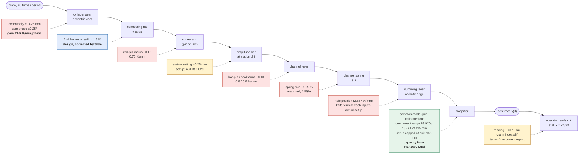
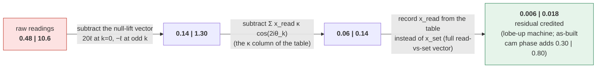
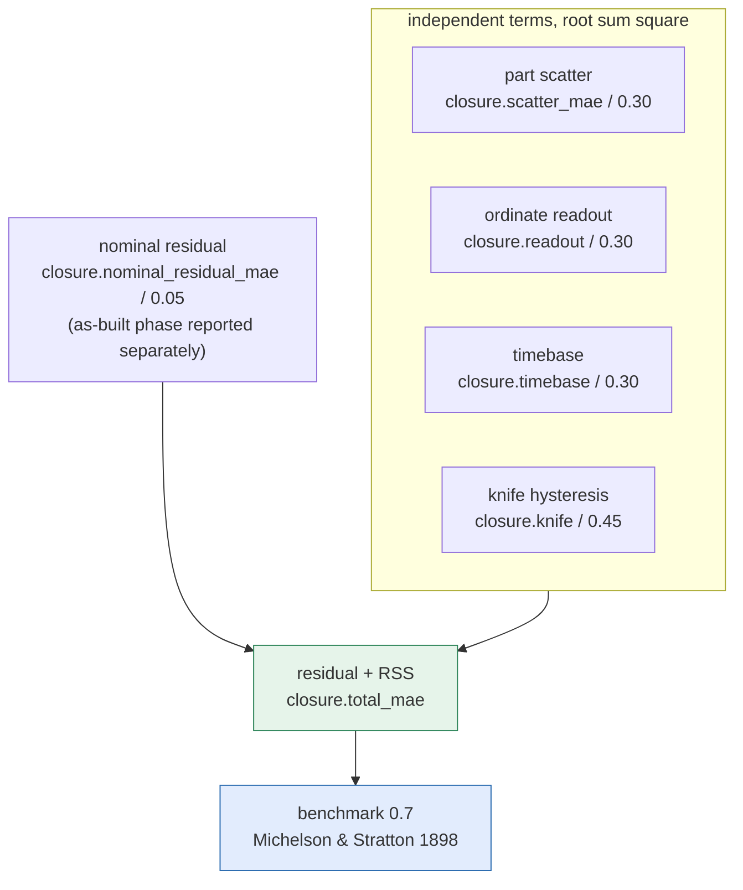
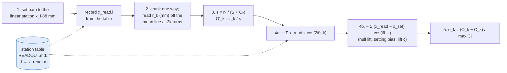

# Tolerance & fits policy

Tolerance is part of the **design source**, not a late drawing annotation. Because the output
is a force balance, *inconsistent* fits across the 20 channels bias the equilibrium rather than
just adding noise — **channel-to-channel consistency matters more than absolute precision**.
Fits are therefore shared parameters applied uniformly, never per-part magic numbers.

## Source of truth

General classes live in [`cad/config/tolerances/_base.yaml`](../config/tolerances/_base.yaml);
fit classes and clearances live in its per-fit-group sibling YAML files
and flow into geometry and into part custom properties. The build scripts read named fit
classes; they do not hardcode clearance numbers.

`tolerances/_base.yaml` owns units and general classes; each
`tolerances/<group>.yaml` owns one fit group. `_config._doc("tolerances")`
aggregates the unchanged document shape. Literal `_config.fit("<group>", ...)`
reads key only that group; dynamic or unknown groups and fit references retain
the whole family. Build subprocesses receive `HARMONIC_FIT_GROUPS` from their
recipe's config dependencies and refuse reads outside that set.

Accuracy-driven limits on the **critical features** live in
[`cad/config/error_budget.yaml`](../config/error_budget.yaml) and are derived — not asserted —
by the sensitivity model [`cad/scripts/error_budget.py`](../scripts/error_budget.py)
(`uv run python cad/scripts/error_budget.py`; gate `check:budget`,
[`test_error_budget.py`](../scripts/test_error_budget.py)). Current derived
results and setup tables come from that report, not copied capacity snapshots.

**What this buys, concretely:** every individual part tolerance on a critical feature can be
traced to a number. Ask "why ±0.025 on the cam eccentricity, why ±1.25 % on the springs,
why ±0.10 on a lever arm and not ±0.05?" and the answer is the sensitivity table, the Monte
Carlo row and the allowance — not a habit. That was the goal of the exercise, and the
per-feature answer is the "Result" section below. The readout procedure turned out to be a
necessary part of the same answer (a tolerance is only meaningful against the accuracy the
machine can reach, and most of that accuracy lives in how the trace is read); it is
explained for the operator in [`device-operation.md`](./device-operation.md), with the
1898 provenance for each step, and shipped as a **manufacturing output**: `error_budget.py
--procedure` renders it from the same model and `cut_release` ships it as `READOUT.md` in the
bundle root with this page, `device-operation.md`
and the pages they `./`-link under `docs/` (`cut_release.operating_docs`), so a builder working
from the release has the station table, every correction and the why, not just the drawings.

The whole-device performance benchmark that constrains this allocation is
[`michelson-1898-trial-accuracy.md`](./michelson-1898-trial-accuracy.md):
approximately 0.7% full-scale mean absolute coefficient error on the historical
80-element machine, largest tabulated difference 2.0%. It is a comparison value, not a
demonstrated target for this project's 20 channels, and it is an assembled-machine output
result, not a percentage to apply to part dimensions. This document is the method that turns
it into dimensional limits.

## How a critical-feature tolerance is decided

A feature earns a tolerance tighter than its title-block general grade only through this
chain; a limit that cannot cite each step is a habit, not a requirement.

1. **Name the transfer quantity** the deviation perturbs: channel *gain*, channel *phase*,
   the *ordinate* setting, *hysteresis/deadband* in the force-summed path, or *readout*.
   A deviation that perturbs none of these (a cosmetic profile, a clearance on a
   one-sided-loaded joint) is not an accuracy feature; it gets a fit class or the general grade.
2. **Classify the deviation.**
   - *Common-mode* — the same on every channel (magnifier ratio, counter-spring rate, a
     spring-preload offset, the slide-arc gain curve). Removed by the calibration run and the
     mean-line zero of the readout procedure below. Free.
   - *Setup* — re-introduced by the operator each trial (measuring-stick reading, alignment).
     A procedure limit, not a machining limit.
   - *Channel-specific* — scatters independently per channel and enters the sum directly.
     This is the only class a **part** tolerance controls.
3. **Compute the sensitivity** — ∂(channel gain)/∂(feature) from the transfer function
   (table below), verified against finite differences of the exact kinematics.
4. **Convert scatter to coefficient error** by Monte Carlo through the readout procedure on the
   reference inputs, in % of the greatest term. Random per-channel gain scatter of σ is
   averaged down to roughly σ/√(2m) over m active channels for a broad spectrum, but shows
   up almost undiluted for a sparse one — so both a broad and a two-channel input are scored.
5. **Allocate** against the benchmark. The channel-specific scatter of every critical feature
   combined may consume at most `targets.scatter_mae_fs_pct` (0.30 % of the 0.7 %); the rest
   is reserved for the nominal-design residual, hysteresis and readout, which are not part
   tolerances. Then compare the derived limit with what a hobby shop and its instruments can
   hold and inspect; if capability is the binding constraint, change the *design* (matching,
   adjustment, calibration) rather than writing an unholdable number.
6. **Pick the drawing limit** as the tightest of (a) what accuracy needs from step 5, (b) what
   the fit class needs (a running fit only exists if the size limits are narrower than the
   clearance band), (c) what the process needs (wall, thread, wear) — and never tighter than
   the tightest of those. The report's `allowable` column is the accuracy bound alone.
7. **Verify on the assembled machine** with the trials in the last section; the model is a
   prediction until a trial confirms it.

### Drive-train gear tips and standard mesh checks

Gear tips take `fits.gear_tip` in `tolerances/gear_tip.yaml` (read through
`_gear_fit_limits.gear_tip_band_mm`), not the routine title-block band: an oversize
tip eats root air and an undersize tip shortens the path of contact.
`standard` (+0.00/−0.10 mm) is the default. `contact_critical` (+0.00/−0.02 mm)
is kept only where a mesh gate needs it: the knob-shaft pinion. It was set for
the 12T:120T reducer, whose contact ratio at the nominal centre was 1.207 at
Ø7.38 (floor 1.2). The 15T:150T reducer (#2034) reaches 1.305 at its nominal
centre, but the far end of its set band, 43.844, holds 1.214 against that
floor. A −0.10 tip costs about 0.05 of contact ratio and would take that end
to 1.167, below it. The 32T alignment and 120T cylinder
tips were contact-critical until the stack6 machinist review. At −0.10 every
drive-train check still passes: alignment backlash, root air and interference,
and cone root air, backlash and interference. Only the reported contact
ratios move.

Every drive-train mesh is accepted by one closed-form AGMA-style check
(`standard_mesh_checks`, applied in `dt_mesh_checks` and
`crank_mesh_stack.standard_check`) plus the native SolidWorks assembly
interference/soundness gate. The check takes each part's printed tip and
tooth-thickness corners (`manufacturing_corner_profiles()`) and the booked
centre range, and reports the contact ratio, the involute interference margin,
exact backlash and root clearance. The crossed 16T:64T is checked in the 64T
normal section (virtual radius R/cos²β, thickness × cos β). Geometry comes only
from the specs and config; no build, drawing or import reads study output.

Cone bands are ordinary (user ruling 2026-10-10): OD +0/−0.05, tooth thickness
±0.075, H7/g6 running bores, 0.05 tooth-cutting runout; T006 alone keeps its
own thin-only bands (thickness +0/−0.04, OD +0/−0.02) for its relief. Gates:

- **Cones T012–T120** (`cone_set_stack`, `dt_mesh_checks.cone_check`): the cone
  centre is set at assembly. Pedestals snug-loose, radial shims at T012 and
  T120, tighten the pedestals, swing T120 in onto its radial feeler, lock the
  cone-lock-knob (MHA-DT-VN-51); the pedestals are not loosened after the set
  (pedestal float booked 0 by that order). Each cone's centre is the set point
  plus its own RSS half-range. Gated: nominal contact ratio ≥ 1.0 at the mean
  centre, positive backlash and no interference at the RSS corner. Reported
  only (REF): the RSS contact ratio and the arithmetic worst-corner
  interference. T012's worst-corner overlap (0.32 mm, REF) is a fit-up note on
  the assembly sheet: if T012 binds after the set, back the swing off or stone
  its tip.
- **T006** (pending exception ruling #971): its DT6-FORM1 relief stands ≥ 0.010 mm clear of
  every printed drum-tip path over the RSS centre range and keeps ≥ 0.02 mm
  backlash; its contact ratio (≈ 0.77) is REF.
- **Crank 16T:64T** (fixed bore, no adjustment): contact ratio ≥ 1.0 at the
  nominal centre, positive backlash and no interference at the worst corner;
  the open-corner contact ratio is REF.

### The chain, and where each error enters

Red = channel-specific part tolerances (the Monte Carlo); yellow = setup/readout terms the
procedure bounds; blue = the nominal design's own distortion, removed by the correction table;
green = common-mode, removed by normalisation. Sensitivities and sizes are the report's.

## Transfer function and error model

The machine draws, with magnifier gain $G$,

$$
y(\theta) = G\sum_{i=1}^{20} w_i\, u_i(\theta),\qquad
u_i(\theta) \approx K\, d_i \cos(i\theta + \varphi_i),\qquad
w_i = \frac{J_i}{D_\theta},\qquad D_\theta=-\frac{\partial \tau_{\mathrm{total}}}{\partial\theta}.
$$

where $d_i$ is the amplitude-bar station (the ordinate), $K = (\text{hook}/\text{bar-pin})\cdot
e/r_\text{pin}$ = 0.0893 mm of spring-hook motion per mm of station (cam throw
$e$ = 8.64, rod-pin radius $r_\text{pin}$ = 133.3, lever arms 175.05/127.0), $s_i$ the channel
spring rate and $J_i$ the loaded spring's torque response per millimetre of vertical
hook lift. The manufactured hook-row position is 39.85 mm; both springs hang plumb in
the neutral pose (the lever reach and the gooseneck arm end are dimensioned for it), so
each force's perpendicular arm is exactly its horizontal offset: 39.85 mm for a channel
spring, 76.20 mm for the counter.
Coefficient $k$ is read at $\theta_k = k\pi/20$. The common stiffness denominator
is removed by calibration, but each channel's numerator remains.

For anchor vector $r$, anchor-to-upper-support span $d$, unit force direction
$\hat{\ell}$, arm $a=r\times\hat{\ell}$ and loaded force $F$, the rotational
stiffness is $s a^2+F(r\cdot\hat{\ell})(1+(r\cdot\hat{\ell})/d)$.
The second term is pretension stiffness: mean-line zero removes constant torque,
not its derivative. Anchor centres rotate with the lever; spring eyes slide on
their seats. `spring_force_model.py` also follows the counter eye's radial contact
with the fixed screw. At the nominal installation, total stiffness is
8697.911 N·mm/rad, and each channel's lift-torque response is 6.978804 N.
Omitting pretension overstates pen gain by about 14.5%.

**Gain sensitivities** (% of channel gain per feature unit; analytic |
finite-difference on the exact kinematics):

| feature | nominal | sensitivity | note |
|---|---:|---:|---|
| cam eccentricity `dt_cylinder_gear_spec.ECCENTRICITY` | 8.64 | +11.57 \| +11.55 | the only dimension with a double-digit sensitivity |
| rocker rod-pin radius `_rocker_interface.ROD_HOLE_X` | 133.07 | −0.75 \| −0.75 | |
| channel-lever bar-pin arm `ch_channel_lever_spec.BAR_PIN_X` | 127.0 | −0.79 \| −0.76 | |
| channel-lever spring-hook arm `ch_channel_lever_spec.LEVER_SPRING_X` | 175.05 | +0.57 \| +0.57 | set by the plumb spring axis (fulcrum 199.9 − anchor 24.85), not a round 7" |
| summing-lever hole position `sm_summing_lever_spec.HOLE_X` | 39.85 mm | +2.667 %/mm | moving the hole changes both the arm and the force direction — and takes the lever reach with it |
| channel spring rate | 0.175127 N/mm (catalog) | +1.00000 %/% | loaded numerator; the common stiffness denominator calibrates out |
| channel initial tension | 1.77929 N (catalog) | 0.00000 %/N | with the axis plumb the pretension's geometric gain term vanishes; DC zeroing removes its offset |
| rocker slide radius, rod length, cam OD roundness, gear runout | — | < 0.1 %/mm | DC or 2·i harmonic only; not gain |

Phase: 1° of cam phase = 1.75 % of that channel's amplitude at the readout points where
$\sin(i\theta_k)=\pm1$. Gear tooth errors convert at the *driven* gear's radius (a 0.02 mm
flank error on any cone gear is 0.02/30.6 rad = 0.04° of the cylinder gear), so tooth
accuracy is not a phase driver; cam-lobe-to-notch registration and one-directional backlash
lag are.

### The nominal design has a residual before any tolerance

The exact kinematics (eccentric + rod on the rocker's −X crank side + rocker pin on an arc + the
rigid 801.95 mm bar whose notch-roof contact rides the R800 slide on the +X side + lever arc,
exactly `build_ch_channel_assembly._arc_geometry` / `solve_state`) are not a pure cosine. From the
report (gain measured from the null station; the sign is the machine-hand convention — the lobe
lifts the crank side, so a +X bar reads negative at the top of stroke):

| station (mm) | gain / linear | 2nd harmonic / fundamental |
|---:|---:|---:|
| +88 | −1.025 | 1.4 % |
| +44 | −1.015 | 1.7 % |
| +22 | −1.012 | 1.9 % |
| +10 | −1.011 | 2.5 % |

Stations are non-negative: the built CAD keeps every bar on the lifting side of the pivot
(`build_ch_channel_assembly` rejects `amplitude_mm < 0`), so a signed input function is **lifted by a
constant** before analysis and the constant's lift vector ($20c$ at k = 0, $-c$ at odd k under
the 20-element rule) is subtracted from the readings. The ledger's "opposite end = 180° phase reversal" is not a mode of the
CAD as built and is not budgeted.

- **Slider-crank distortion**: rod/throw ratio $e/L$ = 8.64/163.1 gives a second harmonic of
  $\approx e/4L$ = 1.3 % of each channel's amplitude, 1.4 % at full scale rising to 6.5 % at an
  idle bar once the arc geometry is added (the idle bar's small fundamental makes the ratio
  large). It aliases onto every readout point (channel 20's 2nd harmonic is +1.5 % at *all*
  $\theta_k$), so uncorrected it costs 0.1–0.2 % MAE and 1.3–1.5 % max on broad inputs and
  1.1 % MAE / 3.0 % max on the two-channel input — larger than every machining term combined.
- **Null station −2.58 mm** (foot-axis x from the pivot): the notch roof touches the arc
  3.175 mm from the foot axis (`ch_amplitude_bar_spec.BAR_WIDTH/2`) and the arc's low point sits
  8 mm above the pivot centreline, so a bar at the geometric zero still moves — 18 idle bars at
  "zero" add a coherent 2.9 %-of-full-scale error each (up to 24 % max on a two-channel input if
  it is ignored). The null station is on the side of the pivot the CAD cannot build, so it is
  **not** where the stick zero goes; because the gain from the null is linear to 0.2 % over the
  range, every bar reads as ordinate $(d_i - d_0)/d_\text{max}$ — a **known common lift of
  0.029** on every channel. Under the machine's own 20-element rule a constant lift $\ell$ reads
  as $20\ell$ at k = 0 and $-\ell$ at every **odd** k ($\sum_{i=1}^{20}\cos(ik\pi/20) = -1$ for
  odd k, 0 for even k ≥ 2), so the correction is a fixed vector subtracted from every trial —
  not a k = 0 adjustment alone (ignoring the odd-k term would leave 0.2 % on a broad input and
  2 % on the two-channel case).
- **Gain non-uniformity** 1.0 % to 2.5 % across the range, once measured from the null station —
  large enough that a millimetre-ruled stick is wrong by up to 0.06 % MAE / 0.33 % max on the
  Gaussian input. The stick stays a linear rule (14.20 mm per division, as engraved); bars are
  set to linear stations and the ordinate each one *reads* is a **table lookup** in the shipped
  `READOUT.md`, subtracted as a read-vs-set vector — the correction Michelson built into his
  "hand stamped, unevenly spaced" stick.

All three are deterministic functions of the design, so they are removed by procedure, not by
tolerance (readout section below). With the calibrated stick, the read-vs-set vector subtracted
and the second-harmonic correction applied, the nominal residual falls to ≤ 0.01 % MAE / 0.03 %
max on every reference input — the "+cal stick" column of the report — **on a machine whose cam
lobes stand vertical at crank home**. The as-built CAD's do not (1.5° off, the tooth-in-gap lock:
open item below, #749), and that common phase leaves 0.15–0.30 % MAE / 1.7 % max that none of
these corrections touch; the closure credits the lobe-up machine under an explicit waiver.
Lengthening the rod would remove it by design but is not photo-faithful; the correction is the
period-appropriate answer (the machine computes, the operator corrects a known table).

What each correction in `READOUT.md` removes, on the nominal (perfect-parts) machine, % MAE of
the greatest term (Gaussian input | two-channel input):

## Result: the budget for the critical features

Monte Carlo of [`error_budget.yaml`](../config/error_budget.yaml) (4000 draws,
zero-centred features uniform within ± tolerance per channel; `cone_flat_play`
instead draws the physical .0004–.0012 in (0.01016–0.03048 mm) across-flat
clearance around its 0.02032 mm mean — `class: channel` drawn once per draw and shared by every trial,
`class: setup` (station setting) redrawn per trial as the operator resets the bars — applied to each bar's **physical hook waveform** at its
station — so a gain error scales the channel's second harmonic, a phase error rotates it, and a
kinematic deviation (eccentricity, the rod pin, the lever's bar pin and spring eye: `feature_axes`) **reshapes** it
through a linearised deviated cycle (central differences of the exact kinematics, exact to 1e-6 of
the stroke), so the operator's fixed κ row is wrong for that channel by the amount the tolerance
moves c2/c1 — second order, but scored, not assumed. A hole held by a diametral **position zone** draws
**both axes** (the zone's bounding square): the rod pin's tangential offset and, on the lever, the hook-line
skew a tangential hole offset amounts to — 10–30× weaker than the radial arm, but sampled, not assumed —
then through the shipped readout;
every bar at the physical amplitude its station reads — an idle bar's ≈ 0.028 of motion is perturbed by its own channel's
deviations too), % of the greatest term. "broad"
pools the all-ones, half-rectangle, Gaussian and lifted-square (odd channels on) inputs; "pair" is channels 1 and
20 alone, the consistency stress case. `allowable` is the tolerance at which a
*zero-centred* feature alone would consume 0.05 % MAE or 0.5 % pair-p99, the
equal-share allocation. The D-flat play's per-land mean residual survives even
with no clearance scatter, so no linear allowable half-width exists for it.

The configured limits and their holding methods remain in
`error_budget.yaml.critical_features`; the model derives their error shares at
each input's **conservative operating-band setup**. Read the current report
rather than carrying forward statistics or allowables from nominal model travel:

| current result | report source (`error_budget.py --json`) |
|---|---|
| feature's broad MAE and broad p99 maximum | `monte_carlo.per_feature.<key>.mae` and `.p99_max` |
| feature's sparse-pair p99 maximum | `monte_carlo.per_feature.<key>.per_input.pair_1_20.p99_max` |
| accuracy-only allowable tolerance | `monte_carlo.per_feature.<key>.allowable_tolerance` (`null` where a linear allowable is invalid) |
| all-feature broad MAE and p99 maximum | `monte_carlo.combined.mae` and `.p99_max` |
| all-feature sparse-pair p99 maximum | `monte_carlo.combined.per_input.pair_1_20.p99_max` |
| broad and joint two-channel acceptance | `closure`, checked by `budget_closes` against config targets/allowances |

Changing the capacity changes station scales, scatter and spring loads. A
previous passing snapshot is not evidence for this range. Even a passing
current report does not discharge the operating assumptions or waivers below.

- **Spring-rate matching dominates the part budget.** Match all 20 rates within
  ±1.25% of their measured common mean and record each initial-tension intercept.
  The catalog's ±10% rate band alone is not acceptable for channel consistency.
  The MHA-CH-VN-50 channel-spring sheet's matched-set note orders 40 from one lot and
  keeps the 20 that match; if a lot cannot supply a matched set, select another
  lot rather than modifying the approved lever holes.
- **The eccentricity limit is capability-driven, not accuracy-driven.** The
  drawing's ±0.025 (`dt_cylinder_gear_spec.ECCENTRICITY_TOLERANCE_MM`) is held by an
  indicated offset in a 4-jaw. Compare it with the current report's accuracy-only
  `allowable_tolerance` before proposing a change; the budget pins that tolerance
  to the yaml so they cannot silently diverge.
- **Lever-arm accuracy and bore fit are different requirements.** Compare the
  general ±0.10 arm limits with the current report's accuracy allowables; their
  bores still carry `shaft_in_bushing` for the running fit.
- **Summing-lever hole position is the relevant plate gain tolerance** (2.667 %/mm across the
  knife line). Drill the 20 holes from one fixture; the along-knife pitch can be loose.
- **Phase is cheap if clocks share their datums.** ±0.25° cam-lobe/notch phase
  is 0.13 mm at the notch. All shaft flats are milled at one clock and each
  cone gear's teeth are indexed from its D-bore flat on one setup. The D-flat
  angular play is larger on the smaller lands (half-chords ≈2.584, 1.723,
  0.861, 0.431 mm on Ø9.525, Ø6.35, Ø3.175, Ø1.5875). A land accepted at its
  least diameter and greatest AF has a shorter flat still (2.498, 1.636,
  0.772, 0.396), and the title block lets each flat's torque corner lose
  0.25 of that to an edge break. The budget books both at their worst:
  levers of 2.248, 1.386, 0.522 and 0.146 mm, so the tip land's play is
  about three times the sharp nominal's. Its common large-land mean lag is a
  crank-index time shift, but neither the smaller-land residual nor
  independent .0004–.0012 in clearances are. Crank in one direction only; a
  reversal re-seats every mesh on the other flank (0.05–0.20 mm backlash).
- **Every clearance in the position-driven chain is benign under one-sided load** — strap on
  cam, rod pin, rocker pivot, bar foot, top pin, spring hooks — because the channel spring
  preloads the whole chain in one direction for a station of fixed sign. The strap's
  0.20 mm diametral clearance would otherwise be a 2.3 %-of-amplitude step: it becomes a DC
  offset the mean-line zero removes. Fit classes on these joints exist to prevent binding, not
  for accuracy; do not tighten them in the name of accuracy.

### Terms the budget reserves outside the part tolerances

| term | assumption (`error_budget.yaml reserved:`) | value | allowance |
|---|---|---:|---:|
| nominal residual after correction | table-lookup setting + read-vs-set vector + 2nd-harmonic correction (all in `READOUT.md`), **on the lobe-up machine** (`reserved.nominal_residual_mae.waive_cam_home_phase`, #749). The as-built common cam phase leaves a residual no step removes; both cases are reported | `closure.nominal_residual_mae` / `.nominal_residual_mae_as_built` | 0.05 |
| ordinate readout | ±0.075 mm reading uncertainty assumes a 0.15 mm technical-pen line; the CAD marker does not establish that performance. Gain uses `wire_moment_arm`, including the fixture's signed hook offset and installed wire lean, at the **conservative component operating minimum**, not a collar or nominal travel endpoint. Capacity and each reference input's scale come from `closed_form.mg-magnifier`; every coefficient carries its own reading error and the k=0 normalizer's through its actual stroke fill | `closure.readout` | 0.30 |
| timebase | stop the crank at 2k turns, repeatable to ±8° (uniform). Evaluate the shifted physical trace through the readout procedure at each input's actual setup, not the ideal Fourier-vector slope | `closure.timebase` | 0.30 |
| knife-edge hysteresis | rolling-resistance length 0.005 mm at each case's rest/preload force sum. `closed_form.knife` reports the worst case and each scaled station vector's spring loads/counter setting; the configured CAD case is not universal preload. The conservative numerator sums force magnitudes and reports the smaller resolved vertical load. The denominator remains the neutral small-signal loaded lift response, not a station-exact or cycle-peak transfer. Confirm gravity, operating loads, contact material/finish and reversal trace width on hardware | `closure.knife` | 0.45 |
| **total** | residual + RSS(scatter, readout, timebase, knife), with credited and as-built cam phases reported separately | `closure.total_mae` / `.total_mae_as_built` | **0.7 benchmark** |
| **two-channel worst coefficient** | all sources drawn jointly through the sparse-pair readout; compare expected largest coefficient error, not an ensemble quantile, with the historical benchmark. `pair_joint` also reports quantiles and the fraction exceeding it | `closure.pair_worst` | **2.0 benchmark** |

`check:budget` fails if a scored term or total overruns its allowance. The wire
moment arm at the conservative minimum clamp station limits ordinate capacity;
the current report derives every reference input's reduced station scale and
the resulting readout, scatter and knife terms. A longer pen stroke or a clamp
reaching nearer the knife would be a design proposal requiring native
operating-pose validation, not a tolerance adjustment. The current minimum
component station remains waived under #748.

How the benchmark is allocated (all terms in % of the greatest term; current
values are generated by the report):

Each node identifies its current report field and allowance
(`error_budget.yaml reserved:` and `targets:`). Compare those generated values
after any change to capacity, station setup or component inputs.

## Readout and calibration procedure (what the model assumes)

The Monte Carlo and the residual numbers above hold only under this procedure; it is part of
the specification.

$S = \sum_i x^\text{read}_i$ and $C_2 = \sum_i x^\text{read}_i\kappa_i$ are the two sums the
operator forms from step 1; the table is the only data the procedure needs beyond the readings.

1. **Zero the measuring stick at the pivot** (every station ≥ 0, the only side the CAD builds)
   and **set each bar to its linear station** $x_i \cdot 88$ mm on the engraved 14.20 mm/division
   scale, then **record the ordinate it actually reads** from the station table in the shipped
   `READOUT.md` (verify the table on the assembled machine from single-channel runs: one bar
   alone at each station, its k = 0 amplitude as a fraction of a full-scale bar's). The read
   ordinate differs from the set one — an idle bar at the stick zero reads $\ell$ = 0.029, not
   0 — and that difference is what the correction subtracts. Every trial then carries the read-vs-set vector
   $\sum_i (x^{read}_i - x^{set}_i)\cos(ik\pi/20)$ — for idle bars $20\ell$ at k = 0, $-\ell$ at
   odd k, 0 at even k ≥ 2 — subtracted from every reading (in ordinate units, after
   normalising). Graduate or
   calibrate the stick from single-channel runs, not from a ruler — the gain deviates from
   linear by 0.9–1.1 % across the range (table above), and Michelson's own stick was "hand
   stamped, unevenly spaced" for the same reason. Set each bar by interpolating to 1/5 of the
   stick's 1.42 mm minor division (`READOUT.md` step 1): a 0.28 mm step gives ±0.14 mm
   rounding, ±0.25 mm with eye and parallax — the budget's setting term. A bar at a zero
   ordinate cannot be set below the pivot, so its setting error is one-sided [0, +0.25]: on
   average it stands at +0.125 mm, so **record its read ordinate at that station** (0.0294,
   not the table's 0.0281 at 0) — a lift of the same kind as the null lift, removed by the same
   read-vs-set vector, so only the scatter about it survives; a full-scale bar is one-sided the
   other way, [−0.25, 0] against the travel stop, recorded at 87.875 mm (0.9986). `READOUT.md`
   prints both numbers; the Monte Carlo samples both one-sided bands and subtracts the same
   means.
2. **Normalise each trial by its own k = 0 reading** in the units the operator has: with
   $S = \sum_i x^\text{read}_i$ and $C_2 = \sum_i x^\text{read}_i\kappa_i$ (both ordinate-unit
   sums from step 1) the k = 0 pen reading is $r_0 = s\,(S + C_2)$, so the trial's pen scale is
   $s = r_0/(S + C_2)$ and every reading becomes $r_k/s$ — Michelson's normalisation to the
   greatest term, with no internal unit needed (`READOUT.md` step 3; the model's
   `read_coefficients` is the same arithmetic). This removes all common-mode
   gain, including the magnifier setting, so the magnifier is reset per trial to bring the
   k = 0 term to the full stroke. Its finite range is the conservative component
   band from `mg_magnifying_lever_geom.operating_clamp_radius_band()`: currently
   **83.920 / 165.0 / 193.115 mm** minimum / built / maximum knife-to-clamp-axis
   radii, with this procedure capped at the built **165 mm**. It runs on the
   wire's moment arm, not station radius: the output fixture's hook is toward
   the knife and the wire leans toward the wheel. Read capacity from the
   generated `READOUT.md`, rounded **down** to two decimals, and require
   $P(f)=\sum_i t_i(1+\kappa_i)$ no greater than that limit. Each $t_i$ is the
   table ordinate at $f\,x_i\cdot88$ mm **before division by $f$**; record
   $x^\text{read}_i=t_i/f$ for the sums above. Solve the largest permitted $f$
   from the station table; proportional scaling ignores idle bars' fixed lift.
   Set the clamp from the generated clamp-station table, never by proportional
   scaling of its radius and never beyond the built station. A sparse input
   that cannot fill the stroke there may be scaled up within capacity and bar
   travel; otherwise use its actual reading and score its stroke shortfall.
   Before clamping, verify as-made sliding bore clearance, the entire bore's
   clearance from actual thread/runout and bracket, and cylindrical plain-body
   support beyond the free hemisphere. Confirm the full directional envelope
   lies inside finished stock, not an assumed centred half-depth. More travel
   found by as-made inspection is not published capacity credit. These checks
   and offline wire gaps do not replace native full-stroke proof (#748).
3. **Lift signed inputs**: every bar stays on the lifting side of the pivot (the CAD realises
   no negative station), so add a constant $c$ to a signed function before setting the bars and
   subtract its lift vector ($20c$ at k = 0, $-c$ at odd k) from the readings, exactly as for
   the null lift.
4. **Mean-line zero**: for each trial, take the zero as the mean of the trace over one full
   period, not the pen's neutral position. This removes the one-sided-swing DC, spring-preload
   scatter, strap-clearance offsets and tare drift in one step.
5. **Second-harmonic correction**: subtract $\sum_i x^\text{read}_i\,\kappa_i \cos(2 i\theta_k)$
   from reading $k$, with $\kappa_i = c_2/c_1$ the per-station ratio from the report (or
   measured: run channel 20 alone;
   $\kappa = (r_\text{even}-|r_\text{odd}|)/(r_\text{even}+|r_\text{odd}|)$ over its
   alternating readings). Use the **read** ordinate, not the set one: an idle bar still moves
   (its $c_1$ is the null lift), so its second harmonic is $\kappa\,x^\text{read} \neq 0$ — on
   `pair_1_20` the 18 idle channels' $c_2$ is what the correction removes.
6. **Crank in one direction**, and read coefficient $k$ with the crank stopped on its index at
   $2k$ turns (the 80-turn period makes $\theta_k = k\pi/20$ exactly two turns apart) rather
   than at a ruled abscissa on a moving paper.
7. Report errors as $e_k = (O_k - C_k)/\max_j|C_j|$ with $C_k$ computed by the **same
   20-sample rule** the machine realises, so quadrature error is never charged to the hardware.

## Assembled-machine verification (which trial detects which feature)

| trial | procedure | detects | pass |
|---|---|---|---|
| channel consistency | each bar alone at full scale, read the k = 0 amplitude | spring rate, eccentricity, arms, summing holes (gain scatter) | every channel within ±2 % of the mean (the budget's combined worst case is ±2.1 %); an outlier is a spring to swap |
| channel phase | same runs, zero-crossing position vs. expected | cam-to-notch, mesh lag | ≤ 0.4° each (0.25° + 0.14° budgeted) |
| hysteresis | one bar at full scale, crank forward then back slowly | knife edge, wheel bearing, wire preload | proposed: trace width ≤ 1 % of that channel's stroke (an edge rolling-resistance length ≤ 0.005 mm at the derived load) |
| station table check | one bar alone at each station, k = 0 amplitude vs a full-scale bar | slide-arc height, contact offset, gain curvature | matches the `READOUT.md` table; idle bar reads ≈ 0.029; subtract the read-vs-set vector (20ℓ at k = 0, −ℓ at odd k) from every trial |
| broad-input benchmark | Michelson's Gaussian ($e^{-(0.1i)^2}$) and half-range rectangle, corrected readout | everything | MAE ≈ 0.7 %, max ≈ 2 % of the greatest term — historical parity |
| sparse-input stress | channels 1 and 20 alone | consistency without averaging | expected worst coefficient ≤ 2 % (p99 2.383 reported) |
| pinion-spring bend coupon (before forming MHA-DT-24) | cut a coupon from the 2325K19 roll along its 50 in length (bend line across the rolling direction, as the part is cut); bend it 90° and 25° over a 7/32 in (Ø5.56) drill-rod mandrel, R2.78, at or under the R2.8 the ±0.5 formed band accepts on both R3.3 bends; then form one leaf and measure its free preset | whether 17-7 PH Condition C takes the tightest radius the drawing accepts at 0.015 in — the R3.3 nominal is proxied from NASA SP-5089 Table XXXI (hardened STA sheet, 0.012–0.016 in, R 0.13 in), and Condition C has less elongation, so the coupon qualifies the band's low limit, not the nominal | no crack or orange peel on the outside of either bend under a 10× loupe; the free crest preset measures 2.55 ± 0.5 into the flank (the formed band whose every corner the preload and stress gates in `build_dt_drive_train_assembly` walk); a crack moves both nominal radii up until the coupon passes at their low limit, and re-runs the corner gates |

## Fit classes (interfaces that must carry a rule)

| Interface | Class | Intent |
|---|---|---|
| shaft ↔ bushing (crank/rocker/lever pivots) | running clearance | hand-cranked, low-speed → generous slip fit, beginner-safe |
| gear ↔ gear mesh (cone↔cylinder, platen rack) | backlash | zero-backlash-in-CAD gears bind in brass |
| cam ↔ follower / connecting rod | contact clearance | follower rides without jamming at dwell |
| amplitude bar ↔ rocker | sliding side clearance | bar slides without binding through full sweep |
| fastener ↔ clearance hole | close / normal | per fastener class |

None of these is an accuracy feature (see the one-sided-load argument above); their limits are
set by binding, wear and assembly, and the size limits on the mating features must be narrow
enough to deliver the band ([assessment §4](./tolerance-gdt-assessment.md)).

## Verification gates

`verify.py` runs a **tolerance audit** (and writes `cad/out/reports/tolerance_audit.csv`) that
fails the build if any part lacks material / tolerance class / process, or any moving interface
lacks a fit class. This is the Gate-E pass. `check:budget` fails the build if the sensitivity
model disagrees with the exact kinematics, a toleranced nominal no longer resolves to the spec
constant the CAD builds from, a drawing limit disagrees with the budget, or the Monte Carlo
leaves its targets.

## Current analytic clearance assertions (kept, being migrated)

The build scripts already assert clearance margins analytically (and raise on violation) — these
are the concrete realizations of the classes above, being lifted into `tolerances/`:

- spring-eye threading margins into the lever hole / under the tab;
- oblique cone↔drum mesh set point (edge slack, `cone_set_stack`). The engaged cone centre is
  set at assembly on T120's radial feeler and locked with the cone-lock-knob (MHA-DT-VN-51); the
  swing stop screw (the shared MHA-SH-VN-52 in its swing-stop occurrence) only limits the disengaged swing;
- rack–pinion backlash;
- bushing clearance under the amplitude-bar foot.

## Open items the budget exposed

- **Summing-lever conventional blind receivers: proof limits.** By explicit
  owner decision, the two **2-56 UNC 2B** taps fasten **MHA-MG-01**, with
  native **2X Ø.070 DRILL .256** and **.195 MIN** full thread. The drill
  takes the **+.004/0 in** drilled-hole row and the **.XXX ±.005 in** depth band.
  The fixed-top **7.00 mm** slab stays at **Y=−4.46..+2.54 mm**. The owner
  moved only the matched mounting row down **0.71 mm**: receiver coordinates
  are **.1280 ±.0020 in (3.25 ±0.0508 mm) below the actual top**, with bracket holes and screws
  following, while the bracket body/seat and threaded-lever pose remain fixed.
  All three rib extrusions are **5.08 mm**, printed **.20 ±.01 in** by one native
  **3X .20** dimension. The drill continues beyond the rib into continuous
  plate material; there is no rib-only drill/thread-depth requirement.
  There is no additional finished-cavity envelope or printed wall acceptance.
  `receiver_pilot_material_wall_budget` / `RECEIVER_PILOT_MATERIAL_WALL_MIN`
  retain the independent **≥.080 in (2.032 mm) pilot-only connected-material** design floor.
  The printed pilot radius **0.9398 mm** and one deepest 0.3° wander charge
  (**0.037669 mm**) leave approximately **2.221731 / 2.579731 mm** top/bottom walls.
  `sm_summing_lever_profile.receiver_pilot_wall_budget` /
  `ReceiverPilotWallBudget` bound longitudinal walls against
  `RECEIVER_PILOT_WALL_MIN` using only the printed pilot radius and drill
  wander, with the printed top/thickness limits and correlated
  actual-top-referenced receiver position. Native trimmed-face clearance
  separately uses **TAP_DRILL_DIA/2**, with actual plate backing checked beyond
  the rib. Pilot volume, end-plane and band checks, drill-lead reserve,
  usable engagement and screw-tip-gap guards remain. Native **4.95 ±0.0508 mm**
  full-thread metadata serves the screw stack, not a maximum cutting reach.
  Pilot/cosmetic-thread geometry does not prove all finished-hole wall thicknesses.

- **Stock spring selection and static balance** (#747). The custom springs have
  been replaced by catalog force curves: twenty hook-ended **9432K31** channel
  springs (0.175127 N/mm, 1.77929 N initial tension) and one double-loop
  **1330K524** counter spring (0.311726 N/mm, 17.0812 N initial tension).
  Static capacity is checked at rest/preload for the full configured 20-channel
  CAD station vector and for every scored reference vector after its actual
  ordinate scaling. Each channel contributes its own catalog force times the
  signed perpendicular arm from `spring_mount_geom.channel_pose`; the counter
  setting is solved in catalog-valid inside length with both force and arm from
  `counter_pose`. A demand outside the catalog force/length interval has no
  setting and fails unconditionally; it is never extrapolated. The report names
  the worst required setting/case and retains scalar knife/error values only as
  documented worst-case summaries. Knife rolling resistance conservatively uses
  the sum of spring-force magnitudes for each case and reports the smaller
  resolved vertical knife load beside it.
  This is not a full-crank load sweep and does not prove gravity, operating
  loads, writing friction, dynamics, or the actual batch's force curves.
  For assembly calibration, use the recorded channel-set rate mean and each
  channel spring's initial-tension intercept, together with the measured
  counter-spring force curve. Slide the gooseneck until the summing lever is
  level; this setting includes the mechanism's weight and actual spring
  preloads. Verify that the assembled mechanism remains within the measured
  counter spring's service range. Native mass/COM readback remains
  the conservative gravity check; it includes the pen carriage reflected
  through the wheel, spring/wire weight and wheel imbalance, without helpful
  guide friction. Verify assembly fit and measured force curves before closing
  #747. The minimum magnifier pose remains #748 and the cam-home phase remains
  #749; this preload correction changes neither limitation.
  Lower anchors are **9489T111 #6-32**, supplied hex nuts discarded, shanks
  trimmed to **18.6 mm** (**31.3 mm** overall to eye crown), each locked by
  an **MHA-CH-14 jam nut** on the coefficient plate underside. The neck seats
  on the fixed plate top; one turn maximum back-out is retained for preload
  trim, then the nut is tightened while holding eye clocking. The uniform
  **7.00 mm** coefficient plate spans local **Y=−4.46..+2.54 mm**; it is
  thickened downward, not recentered. This retains the world top **982.24 mm**,
  nut seat **975.24 mm**, all twenty stations and the **Ø.006 RFS** pattern.
  Worst-case anchor sizing retains two full turns beyond the jam nut through
  the 6.49–7.51 mm plate limits. The counter **9490T1 #10-24** keeps its
  boss-through trim and top jam nut; neither counter anchor nor boss pose
  changes. Existing upper lever holes are retained, with no upper pins.
  View G's actual-edge boss-top/coefficient-top location is
  **9.525−2.54 = 6.985 mm**, printed **.28** under the `.XX` ±.01 in band.
  The **19.05 mm** boss and **5.08 mm** web remain centered on Y=0; the web
  top is flush with the coefficient top. Neither feature is referenced to
  the asymmetric slab midplane. The existing sheet-2 isometric shows the
  underside rear-bottom-right **(+X,−Y,−Z)** at **1:4**, keeping six views.
  The gooseneck head remains Ø12 mm to retain the counter's double loop.
  Option A's historical source-union estimate at the prior **8.20 mm** receiver
  depth is **+6.769 cm³**, approximately **49–53 g**,
  only at illustrative density 7.2–7.85 g/cm³; its signed-change centroid is
  **(22.744, −3.517, −0.0777) mm**, not the final part CG. The corresponding
  level-pose gravity moment is **10.87–11.85 N·mm**, excluding out-of-plane
  root-blend changes and every later rib-depth change, including the current
  uniform **5.00 mm** ribs. These are historical estimates, not current
  mass/CG acceptance values (derivation and limits in [machining DFM](machining-dfm.md#summing-lever--knife-edge-t1--least-forgiving-interface)).
  Added +X gravity reduces required counter tension: the installed margin
  that matters is force above the measured initial-tension floor, not catalog
  maximum-minus-force or full catalog span. The default static balance/error
  budget omits lever gravity. Native mass/CG, underside and operating-pose
  swept-clearance checks, and measured installed balance remain outstanding.
  Assembly seating uses the native supplier surfaces, not the ideal-circle
  offsets used to initialize the model. Supplier and replica probes found the
  same 3.7–4.4 µm departure from the nominal round-wire envelope at the counter
  contact. The builders bracket actual assembly interference and take the clear
  endpoint to 0.000001 mm positional convergence; they do not waive small
  intersection volumes. A current seat has zero reported interference and either
  native minimum separation at most 0.000010 mm, or positive native interference
  at a position no more than 0.000001 mm inward. The latter is an explicit
  collision bracket, not an overlap allowance at the saved position.
  Minimum-distance readings are retained and disagreements are warned: the
  production channel fixture reports 22.2 nm at a clear endpoint within 1 nm of
  a native collision. No artificial clearance offset is added.
  Channel variants are rebuilt and remeasured at their corrected installed
  lengths. The counter's length and pull axis stay fixed while its
  lower seating and gooseneck position are resolved. The force budget remains a
  catalog-nominal engineering model, not an elastic-contact simulation; measured
  force curves and assembled zeroing remain required.
- **The cam lobes stand 1.5° off vertical at crank home** (#749). The drive train locks every
  cylinder gear at Rz(+1.5°) — half its tooth pitch, tooth-in-gap against the phase-0 cones
  (`gear_train.cylinder_lock_phase_deg`) — and the cam lobe is a tooth crest, so at crank home
  every lobe sits 1.5° off. Channel i turns i× faster than the crank, so no crank index zeroes
  all 20: it is a *common cam phase*, and its error h·Σ xᵢ sin(iθₖ) is the sine transform the
  machine does not read — no procedure step touches it. The current report's
  `cam_home_phase` and `closure` score the as-built residual and total beside the
  credited lobe-up case; do not carry a total over from another capacity range.
  Cut the lobe half a pitch from the tooth crest without changing the gear mesh
  phase; reconcile the resulting rod/rocker rest closure before rebuilding.
  `verify:kinematics` uses a prescribed pen driver, not forces from the cams.
  `check:budget` scores the as-built residual beside the lobe-up one and fails
  unless `reserved.nominal_residual_mae.waive_cam_home_phase` is set; the waiver is set, and
  **the closure above is conditional on that cut**.
- **Magnifier range / ordinate capacity** (#748): keep three distinct claims.
  **Nominal model travel** is `clamp_radius_band(block_depth)`, for visualization
  and export only. **Published component operating bounds** come from the
  no-argument `operating_clamp_radius_band()`, currently
  **83.920 / 165.0 / 193.115 mm** from knife to clamp/bottom-rod axis.
  **As-made fit-up** may admit more travel after inspection, but that extra
  travel is not advertised as capacity. No physical model pose or part
  geometry changes with this conservative capacity policy.

  Installation is located by fitted tip projection $P=1.25\pm0.51$, not a
  fixed nominal free-tip coordinate. With knife-to-bracket-centre $C=55$,
  thickness $N=12.5\pm0.8$, rod $L=167.5\pm0.8$ and thread
  $T=18.00\pm0.51$, the free tip is $K=C-N/2-P+L$. Use the **full 17 mm
  one-sided calculated body bound** from the actual interior tap axis, never
  ±8.5 mm symmetry. The nearer operating bound is
  $\max(C-N_{\min}/2-P_{\min}+T_{\max},C+N_{\max}/2)+17=83.920$ mm;
  overall rod length cancels. At the far end,
  $R_{\max}=K_{\min}-D_{\max}/2-17=193.115$ mm. The shortest rod,
  thickest neck and largest projection reduce that available plain length
  together. Nominal X149.50 runout and a fixed nominal free-tip coordinate
  earn no capacity credit. These are conservative **component intervals**,
  not native all-machine kinematic clearance.
  The derived bound includes ordinary HEX size on all three opposed-flat pairs
  and default drawn angles over the full height. It is not a separate printed
  envelope inspection or a guarantee for unconstrained as-supplied form.

  The bracket-arm load screen uses the same fitted frame for gravity:
  $a_{\max}=L_{\max}-N_{\min}/2-P_{\min}=161.710$ mm from the neck,
  rather than the nominal fixed-tip 160 mm. It conservatively applies the
  whole lever-group weight at that station; the built hook, wire direction,
  neck and relocated mounting row retain their actual machine coordinates.
  Joint moments use that actual row's centroid projected to the seat plane,
  including its −0.71 mm relocation rather than the old nominal row.
  Section calculations use minimum accepted **11.7 × 10.9 mm**, not nominal
  12.5 × 11.0; the longest printed seat distance, independent head locations
  and shortest grip bound the arm span at **97.965 mm**. The force directions
  and X/Y load stations remain the nominal A1 installation, not an
  all-geometric-variation or native articulation certificate.
  Its material report remains a load-demand estimate with assumed elastic
  moduli, not a certified strength or safety factor for generic low-carbon steel.

  What the pen sees is `error_budget.wire_moment_arm`, resolved from the same
  signed hook offset and wire tangent as the built run, not the clamp radius.
  With $g(R)=\texttt{pen_gain}(R)$ and $F$ the full-scale channel lift, the
  computed ordinate capacity is
  $C=H/[g(R_{\min})|F|]$, where $H$ is the pen half-stroke. The fitter uses
  $P(f)\le\lfloor100C\rfloor/100$, solving the station table for $f$.
  `closed_form.mg-magnifier` reports the actual arms, gains, capacity, scales
  and stroke fills; `READOUT.md` generates the settings from those values.
  This procedure remains capped at the unchanged built **165 mm**, not the
  component-only upper bound. These are local linearized values, not a
  force-driven motion simulation.

  **Only the built pose is CAD-gated.** Native clearance and articulation at
  the minimum component station remain unproven; `check:budget` names every
  scored input below the built station and fails unless
  `reserved.readout.waive_minimum_pose` is set. That waiver remains set and
  closure remains conditional on #748. The report's offline straight-wire
  surface gaps are not proof of clamp, rod, threaded bracket or frame
  clearance. The fitter must verify as-made sliding bore clearance, thread/
  runout and bracket clearance, and full-bore support beyond the free
  hemisphere, then validate the full required stroke in both directions at
  minimum and built settings, including nonlinear spring equilibrium and wire
  tangency. Distinguish physical wire pitch radius from display stand-off.
  The counter eye's mid-shank axial station is a placement convention; check
  axial contact migration and retaining-head clearance rather than assuming
  friction holds that station.
- **Knife and pen performance still need physical evidence.** The 0.005 mm
  rolling-resistance assumption is not established by a material name or the
  current surface-finish callout. Measure a slow reversal with one channel
  active; if it fails, investigate the knife/seat material, finish and contact
  geometry before tightening unrelated dimensions. Likewise, verify the
  assumed 0.15 mm line with a compatible technical pen or score the actual
  marker/readout uncertainty. A prescribed pen-motion equation proves neither.
- `amplitude.max_travel_mm` 88 vs. the ledger's ±146 mm foot travel: the budget uses 88; a
  larger full scale improves every readout term proportionally.
- A change to the eccentricity drawing limit (±0.025) requires comparison with
  the current report's accuracy allowable; the budget pins the agreed limit.

## Scope of manufacturing outputs

Reassessed in [`tolerance-gdt-assessment.md`](./tolerance-gdt-assessment.md) §11 — nothing here is
left "deferred":

- **GD&T (full, ASME Y14.5-2018), surface-finish specs, critical-feature callouts — IN SCOPE.**
  Held in config, stamped into the model as PMI, imported onto the drawings, audited. The full
  vocabulary is available — form, orientation, location (true position + MMC/LMC bonus), profile,
  and runout, over explicit datum reference frames — applied **functionally**: a feature-control
  frame appears only where the error model rewards it (the knife edge, the cams, channel
  consistency), and a general tolerance block (an ASME decimal-place title-block table; ISO 2768 if
  drawing to ISO) governs everything unspecified. This
  **retires the earlier "lite" cap** that limited geometry to dial-indicator runout on the theory the
  audience couldn't parse frames — the supplement now ships a GD&T primer instead (see assessment
  §1/§5).
- **2D shop drawings — IN SCOPE (planned).** A hobby machinist builds from a dimensioned, toleranced
  print, so generated PDF drawings (Tier-1 precision-critical parts first) are the vehicle that
  carries the tolerances to the bench. Same `SaveAs3` path the STEP/STL export already uses; a new
  `drawing:<stem>` doit task that takes the COM seat lock.
- **CAM (STEP→CAM→G-code) — IN SCOPE, deferred until the nominal model is frozen and validated.**
  The build is manual-primary for fidelity, with the PM-30MV **CNC** cutting the repetitive high-count
  parts (20 cams, 19+19 spacer bushings, cone/cylinder gear train). The primary feed is the **3D solid
  via STEP** (emitted by `SaveAs3` in `export_models.py`/`cut_release.py`) into **Fusion 360**
  (Makers SKU) → G-code; CAM cuts nominal, so the toleranced print carries fits/finish. **Caveat:** the
  neutral export writes one STEP per SLDPRT (active config), so a multi-config part like the 20-config
  `dt-cone-gear` needs a **per-config STEP export path added** before all 20 can be fed to CAM (see the
  assessment §11). Authored after the §4 Findings close. Manual mill + lathe still make every one-off part.
- **DXF — narrow role, NOT the primary CAM feed.** 2D only; used only for genuinely flat parts, 2.5D
  contour/indexed profiles (cam/gear-tooth flanks), and inspection-reference overlays — subordinate to
  the STEP→CAM path (which handles the real 3D solids). Carries geometry, not tolerances.
