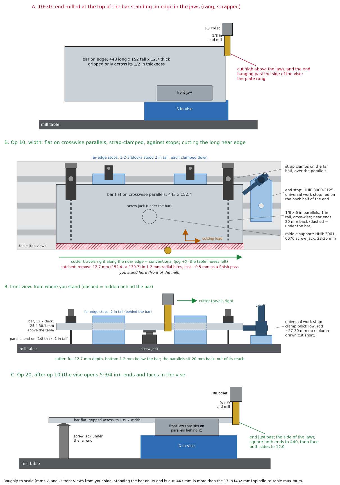

# Get the pendant working, then rough the base bar to length

Continues [2026-10-29](2026-10-29-vise-install-and-first-cuts.md).

## Setup

- **Stock:** the 443 mm piece I sawed on 10-29 from the 1/2 × 6 in 6061-T6511
  bar, for the oblique-jig base bar (`ch-rocker-arm-tl-oblique-base-bar`,
  MHA-CH-06-TL-20). The goal was to rough the end down to the 440 mm length.
- **Workholding:** same as 10-29. The bar stood on edge in the 6 in vise's hard
  jaws, gripped across its 1/2 in thickness, about 6 in sticking up.
- **Tooling:** a 5/8 in 4-flute TiN-coated HSS end mill that was lying around,
  in a 5/8 in R8 collet. I used it instead of the plan because I was curious
  how hard I could push the machine. Tap Magic as the cutting fluid.
- **Control:** CNCjs on the laptop, the pendant as the handwheel, and the EL400
  simulator as the DRO. Spindle speed set by hand on the knob.
- **Speeds and feeds (suggested, not what I ran):** I asked Claude. It
  suggested starting side roughing at 1700 rpm, 400 mm/min, 0.500 in axial
  depth and 0.060 in radial step-over, and full-width slotting at 1500 rpm and
  230 mm/min. It said to use conventional milling if the machine still had
  backlashy lead screws. What I actually ran is in the table below; my
  starting depth and step-over weren't recorded.

## Operations

| # | operation | tool | RPM | feed | DOC | result |
|---|---|---|---|---|---|---|
| 1 | get the pendant talking to CNCjs | — | — | — | — | works after installing a driver |
| 2 | touch off on the bottom-right corner | side of the cutter, spindle turned by hand | — | — | — | Y travel about 5 mm short of the top-left corner |
| 3 | side-mill the end (climb, without realizing) | 5/8 in 4-fl TiN HSS | on the knob; not recorded | 400 mm/min | radial in 0.100 or 0.150 in steps; axial not recorded | chatter; needle chips |
| 4 | side-mill the end | same | 1500 | 400 mm/min | 0.150 in radial, 1 in axial | loud ringing; I backed into the cut; spindle e-stop; cutter pulled 1/4 in out of the collet; part gouged |
| 5 | full-width shallow cuts | same, reseated | 1500 | 230 mm/min | not recorded | a lot of chatter; loose arc chips |
| 6 | full-width shallow cuts | same | 1000–1200 | 230 mm/min | not recorded | acceptable |

## Measured

Nothing. I didn't remeasure the piece before cutting, and I haven't measured
the scrapped piece yet.

## What happened

**The pendant mostly works now.** Yesterday it wouldn't send its events to
CNCjs. The fix was installing a driver, which Claude sorted out. I used the
EL400 simulator only to check that it's integrated, not for any actual cuts.
What's still wrong or unclear:

- I can't tell how to switch the pendant display between work and machine
  coordinates.
- The feed rate shows in mm even in inch mode.
- The link to the microcontroller is very slow. If I jog quickly in step mode,
  the jogs queue up as G-code lines and the table keeps moving after I stop,
  in one case all the way to the end of the table. The pendant's stop button
  stops it within about a second.
- The pendant stops working when the laptop screen turns off.

Since step jogs queue up anyway, I set the step jog to 400 mm/min in the
pendant config and used it as a poor man's power feed. It worked OK. Proper
macros are the real fix.

**I deviated from the plan.** I picked up the 5/8 in 4-flute end mill to rough
the end of the bar down to length, partly to see how much the machine could
take. I followed the speeds and feeds at first, setting the RPM on the knob and
the feed in mm/min, but I don't remember the depth and step-over I started
with. Then I made several mistakes.

**I forgot how much I was supposed to rough off,** and removed too much. I
should have remeasured the piece before cutting. I also kept forgetting
whether I was taking 0.100 or 0.150 in at a time, so I was never sure the
cutter was where I thought it was.

**I was climb milling while I thought I was conventional milling.** I only
worked it out the next day at home, holding my right hand thumbs down with my
fingers playing the cutting side of the end mill.

**The axes confused me.** A positive X or Y jog moves the table toward me and
to the left. That makes sense from the end mill's point of view, but positive
Z is up. I jogged in the wrong direction many times.

**The scary one** (video 04:31–05:11). I was taking 0.150 in radial at 1 in
axial depth, 1500 rpm and 400 mm/min, and the part started ringing loudly. I
tried to back off in Y, went the wrong way, and pushed the cutter further into
the cut. That made it worse, and I hit the spindle e-stop. The force pulled
the end mill 1/4 in down out of the collet. I noticed because the uncoated
part of the shank was sticking out below the collet. The end mill looks fine,
so I reseated it and carried on. The part was gouged, and that's when I
realized it was scrapped.

**Side milling was a bad choice here.** It made a lot of chatter. Shallower,
full-width cuts at 230 mm/min went better. Spindle speed mattered: a
full-width cut that chattered a lot at 1500 rpm was acceptable at 1000 to
1200 rpm.

**Chips looked good,** breaking off cleanly: needle chips from the side
cutting and loose arc chips from the full-width cuts (chip shapes as in
[this chart](https://ars.els-cdn.com/content/image/3-s2.0-B9780444637116000077-f07-02-9780444637116.jpg)).

**I zeroed off the wrong corner.** The table can't travel far enough in Y
toward me to reach the part's top-left corner; it ran out about 5 mm short. I
should have moved the vise and re-indicated it, but I was lazy and zeroed off
the bottom-right corner instead, touching off by turning the spindle by hand
until the side of the cutter met the part. From there I was winging it.

I also kept mixing up axial and radial when reading the speeds and feeds. A
linear pattern on the EL400 would probably have made the repeated passes
easier, but I'd forgotten how to use it.

Next time: follow the plan.

## Cost

- Time: 5 h
  - Pendant 1.5 h.
  - Cutting 3 h.
  - Cleanup 0.5 h.
- Material: the 443 mm piece, scrapped. It may be reusable for another
  oblique-jig part.
- Tooling: the 5/8 in end mill pulled out of the collet under load. It looks
  fine.

## Open

- Practise jogging the machine with the DRO, and relearn the EL400 simulator,
  including its linear pattern.
- Set up proper jog macros for power feed so the serial link isn't overloaded.
- Work out the pendant's work/machine coordinate display and its feed units in
  inch mode, and why it stops when the laptop screen turns off.
- Measure the scrapped piece and check whether it can make another part of the
  oblique jig.
- Move the vise so Y can reach the part's top-left corner, then re-indicate it.

## Advice afterwards (from Claude, not yet tried)

I asked Claude for advice after the session. None of this has been tried at the
machine yet; the next entry will say what held up.

- **Workholding caused the ringing.** The cut was high above the jaws on a
  1/2 in plate, and the end hung past the side of the vise. Both contributed
  (panel A). Lowering the spindle speed is a fine-tune once the setup is stiff,
  not a fix for a floppy one.
- **Op 10, width first, on the table (panel B).** My parallels are 1/8 in
  thick and 6 in long in matched pairs, so they can't run the 443 mm length.
  Stand the 1 in pair crosswise, one 30–40 mm in from each end, with their near
  ends 20 mm back from the near edge so the cutter never reaches them; they
  stick out about 20 mm past the far edge. Put an
  [HHIP 3901-0076 screw jack](https://www.jbtools.com/hhip-23-30mm-adjustable-screw-jack-3901-0076/)
  (23–30 mm, 34 mm base) under the middle on solid table, not across a
  T-slot, and run it up by hand until it just touches the bar at 25.4 mm.
  Strap-clamp the far half, each strap over a parallel, so nothing is in the
  cutter's path. Cut the near long edge with the side of the cutter: axial
  depth is the whole
  12.7 mm thickness (cutter bottom just below the bar, never stepping down in
  Z), radial bites of 1–2 mm into the edge, 12.7 mm in all (152.4 → 139.7),
  with the last ~0.5 mm as a finish pass. Each pass runs the 443 mm length in
  X. Check the real X travel first.
- **Op 10 stops (panel B).** Friction alone holds the bar against the cut, and
  conventional milling along the near edge pushes it away from me and to the
  right. Clamp both 1-2-3 blocks, stood 2 in tall, against the far edge beside
  the parallels: two solid faces stop the bar sliding and turning. At the
  right-hand end, set an
  [HHIP 3900-2125 universal work stop](https://www.jbtools.com/hhip-universal-work-stop-3900-2125/)
  with its rod on the back half of the end face, so the cutter still runs off
  the end: clamp block all the way down (rod about 27–30 mm up; check it lands
  on the 25.4–38.1 mm edge), as little rod sticking out as possible, both set
  screws tight. Its single 3/8 in rod is too springy for the far edge. Clamp
  each stop to the table on its own; a stop that is only pushed against the
  bar gets shoved aside. The new edge comes out straight along X whatever
  angle the bar sits at; a skewed bar only makes the width taper against the
  as-extruded far edge. If an even width matters, indicate the far edge along
  X before the stops go on. Order: parallels and jack, bar, straps snug,
  indicate, stops clamped, jack just touching (never lifting the bar), straps
  tight, then run the whole pass in the air with the spindle off to check the
  collet clears the straps and the work stop's column. (Unverified: neither
  the jack nor the work stop is in hand yet, and the work stop's 1/2 in base
  hole may be too tight for a 1/2-13 kit stud.)
- **Op 20, ends and faces in the vise (panel C).** At 5½ in wide the bar fits
  the 5¾ in vise. Lay it flat on parallels with the op 10 edge against the
  fixed jaw, the end just past the side of the jaws and a jack under the far
  end. The op 10 jack tops out at 30 mm; the bar's underside is about
  86–99 mm up (vise bed 73.3 mm with the swivel base off, plus the
  parallels), which the HHIP 3901-0078 (70–100 mm) covers. Square both ends
  to 440 mm, so they come out square to the machined edge, then face both
  sides to 12.0 mm. Standing the bar on its end is out:
  443 mm is more than the 17 in spindle-to-table maximum.
- **Climb or conventional.** With the spindle running forward, picture the
  cutter's travel along the part: part on the left is conventional, on the
  right is climb. On the near edge in op 10 that means the cutter travels right
  (jog +X, the table moves left). On the right-hand end in op 20, the cutter
  travels away from me (jog +Y, the table moves toward me).
- **Axes.** Every axis describes the cutter moving relative to the part. +Y
  moves the table toward me, which is the cutter moving away; +Z is also the
  cutter moving away from the part.
- **Plan on paper and cut to coordinates.** 443 → 440 mm was only 3 mm; one
  0.150 in pass was more than the whole allowance. Measure first, write
  target − actual = allowance, split it into rough passes plus a finish pass,
  tape the sheet to the machine, zero on the edge and cut to an absolute
  coordinate instead of counting increments.
- **Escape drill.** If it rings or grabs: press the pendant stop and wait until
  all motion has stopped, then retract Z. Never back off sideways while the
  cutter is in the cut. Practise it dry.
- **Collet grip.** Wipe oil and Tap Magic off the collet and shank, tighten the
  drawbar properly, and mark the shank at the collet face to see any creep.
  Keep stick-out short; a 2- or 3-flute end mill clears aluminium chips better.
- **Power feed without overrun.** An incremental MDI move in CNCjs
  (`G21 G91 G1 X-50 F400`, then `G90`, plus `G20` if I was in inch mode;
  `G21` makes it 50 mm at 400 mm/min whatever mode was active) gives an exact
  distance at a set feed with nothing queued (unverified against my
  config). If the pendant can send `$J=` jog commands, FluidNC can cancel a
  jog on release (unverified against my config).
- **Screen off.** Set the laptop's screen and sleep timers to Never while
  plugged in and turn off USB selective suspend (unverified).

## Follows up to

- Module: [`../curriculum/m07-mill-ii-profiling-slots-workholding.md`](../curriculum/m07-mill-ii-profiling-slots-workholding.md)
- Previous session: [2026-10-29](2026-10-29-vise-install-and-first-cuts.md)
- Part: [`cad/config/parts/ch-rocker-arm-tl-oblique-base-bar.yaml`](../../cad/config/parts/ch-rocker-arm-tl-oblique-base-bar.yaml)

## Photos

- Video of the roughing, including the ringing and the e-stop at 04:31–05:11:
  `OneDrive/Imagens/Imagens da Câmera/2026/10/20261031_022544000_iOS.MOV`
  (13 min 19 s).
- The 10-29 photos haven't been taken yet.
