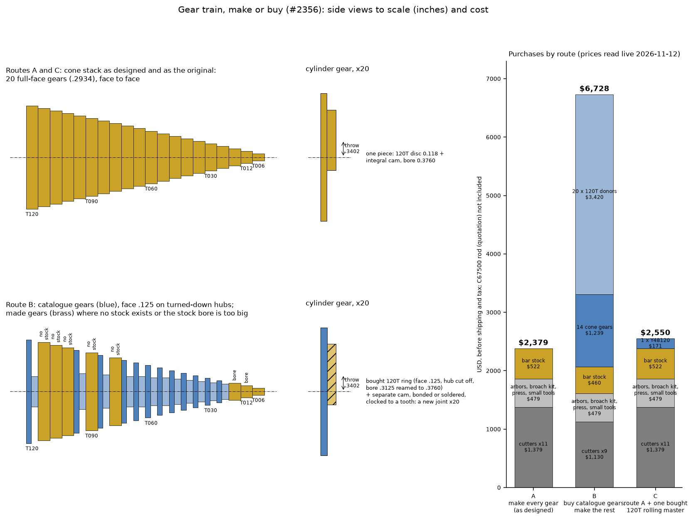

# Gear train: make or buy (#2356)

Decision package for the owner. Status and the ruling live on
[#2356](https://github.com/pedropaulovc/harmonic-analyzer/issues/2356); this
folder holds the evidence. Every SKU and price was read live on the vendor's
own page on 2026-11-12, before shipping and tax. Nobody was contacted and
nothing was ordered.

`compare_routes.py` draws the figure from the CAD specs (gear sizes) and the
catalogue rows below.

## What the original did

The original's cone is twenty full-face spur gears, about 7 mm each, stacked
face to face on one shaft
(`references/albert-michelsons-harmonic-analyzer/ch12_images/page001_img01.jpeg`,
`page003_img03.jpeg`, which dimensions the 7 mm face). The wear line on each
tooth sits in a narrow band near mid-face (`page003_img01.jpeg`): the oblique
mesh only uses part of the face. No photograph in chapters 11 to 13 shows a
bore, so how the original gears are fixed to their shaft is not known from
the book; the text says only that they "are fixed to the same shaft so that
they rotate together". The design's 1/16 key (owner decision C1 keyed,
2026-11-09) stands.

## What the catalogues offer

- **Cutters.** Travers TTC 20 degree involute cutters exist for every number
  the cutter plan names: 48DP #1 to #8 (7/8 in hole, $111.46 to $126.48
  each), 24DP #2 and #7 ($137.59 each, 1 in hole), 32DP #8 ($126.48, 1 in
  hole). Eleven cutters, $1,379.13. McMaster's 48DP cutters are 14-1/2 degree
  only.
- **Catalogue gears.** Boston Gear Y48xx and McMaster 7880K brass spur gears
  are 48DP 20 degree, but with a .125 face (the design's is .2934) and bores
  of .125 to .3125. Nobody lists 78, 90, 102, 108 or 114 teeth. The stock
  bore of the 12T and 18T (.125) is already larger than the design bore
  (.0625). Fourteen of the twenty cone gears could be bought, for $1,239.32,
  and each still needs boring to .375, a broached keyway clocked to a tooth,
  and its hub turned down to hold the .2934 pitch. The cone would then be
  thin discs on hubs, not the original's solid stepped cone.
- **Cylinder gear.** Boston Y48120 (120T, face .125, bore .3125, $171.00) is
  the only donor. Twenty cost $3,420 against one $239.15 brass bar, and the
  integral cam would become a separate part bonded or soldered to each ring
  and clocked to a tooth.
- **Crank pair, drum, paper drive.** No catalogue 20 degree 16T 24DP steel
  spur gear, no 32T or 150T 48DP brass gear; the 64T's inclined teeth are
  always shop-made. The 15T and 12T pinions exist in brass, but the design's
  are integral with their steel shafts.
- **Shaft.** No Ø3/8 shaft is sold with a 1/16 keyway (McMaster's keyed
  shafts start at 3/32), and MHA-DT-04 is stepped with an integral journal
  and collar in any case.

## Routes

| | route | purchases | what changes |
|---|---|--:|---|
| A | Make every gear, as designed | **$2,399** | nothing |
| B | Buy the 14 catalogue cone gears and 20 cylinder-gear donors; make the rest | **$6,514** | appearance of the cone; a new cam joint on 20 cylinder gears; spacer and hub redesign; mesh checks rerun on generated teeth |
| C | Route A, plus one Boston Y48120 as a 120T master to roll cut gears against | **$2,570** | nothing in the machine; one more shop gauge |

All three exclude the C67500 rod for T006 to T024 (5/8 in, about 6 in),
which every mill found sells by quotation only.

Recommendation: **A**. It is the cheapest, it keeps the original's
appearance, and every purchase that replaces a made gear costs more than the
cutter it saves (the four #3-range cones cost $279.03 to buy against a
$126.48 cutter). Route C's master gear is optional: the sheets already accept
each gear by its span or over-pins size and by backlash at assembly.

## Purchase list

Common to every route, $498.48:

| item | SKU | price |
|---|---|--:|
| Stub arbor, 7/8 in, 3/4 straight shank (48DP cutters) | HHIP 3900-0162 | $69.03 |
| R8 collet, 3/4 in, if the shop has none | McMaster 3257A319 | $15.08 |
| R8 stub arbor, 1 in (24DP and 32DP cutters) | Travers TTC 67-600-016 | $76.05 |
| Keyway broach, 1/16-A | McMaster 3153A12 | $100.33 |
| Broach bushing, 3/8-A, collared | McMaster 3151A109 | $23.85 |
| Arbor press, 1 ton (candidate; open height 5-1/2 in is marginal for the 5 in broach) | Harbor Freight 59766 | $79.99 |
| End mill, 1/16, 2-flute HSS, 0/+.002, two off | McMaster 2802A81 | $72.10 |
| Key stock, 1/16 undersized, 12 in (machine key and arbor key) | McMaster 98830A511 | $0.47 |
| 1018 CF round, 3 in x 2 in and 7/8 x 12 in (crank pair) | OnlineMetals 7566, 4796 | $27.36 |
| O1 drill rod, 1/8 and 3/16 x 36 in (T006 form tool) | OnlineMetals 4630, McMaster 8893K178 | $14.29 |
| Dowel pins, 3/8 x 1: one pull-out, one pack plain (cam fixture) | McMaster 97175A348, 98381A624 | $19.93 |

Route A adds the eleven cutters, $1,379.13, and brass bar, $521.58 (six
C360 bars for the drive train, $439.04, and the 3-1/4 in bar for the
paper-drive disc, $82.54). Route B drops four cutters (48DP #3, #5, #6, #8;
#6 and #8 come back because the 12T and 18T cannot be bought) and adds the
gears. Route C is route A plus the $171.00 master.

The records are in `cad/config/shop-equipment.toml` ("gear cutting kit"),
each `present = false`.

## Not verified

- Boston Gear stock status (prices are MROSupply's; its page shows no stock).
- MSC, KBC and Victor cutter prices (Travers, Penn Tool and McMaster were read).
- The broach bushing's collar thickness, which feeds the press height check.
- Whether the shop holds a 1 in R8 arbor or a 3/4 R8 collet already.
